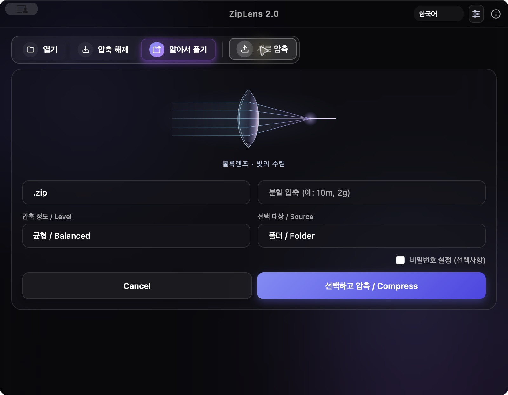

# ZipLens

압축을 풀기 전에 안을 보고, 필요한 파일만 골라 꺼내는 무료 macOS 압축 앱입니다. 압축은 볼록렌즈에 빛이 모이는 모습으로, 압축 해제는 오목렌즈에서 빛이 퍼지는 모습으로 표현합니다.

**최신 공개 프리뷰: ZipLens 2.1.2 · Apple Silicon Mac용**
[다운로드](https://github.com/SeederPowerDrop/ZipLens/releases/tag/v2.1.2) · [2.1.2 업데이트 안내](ZipLens_Astra/docs/RELEASE_2.1.2_KO_EN.md) · [10개 언어 소개·기능·사용 설명서](ZipLens_Astra/docs/guides/README.md) · [지원 형식·빌드](ZipLens_Astra/README.md) · [English](#english)

[한국어](ZipLens_Astra/docs/guides/ko.md) · [English](ZipLens_Astra/docs/guides/en.md) · [日本語](ZipLens_Astra/docs/guides/ja.md) · [简体中文](ZipLens_Astra/docs/guides/zh.md) · [Tiếng Việt](ZipLens_Astra/docs/guides/vi.md) · [Español](ZipLens_Astra/docs/guides/es.md) · [Français](ZipLens_Astra/docs/guides/fr.md) · [Deutsch](ZipLens_Astra/docs/guides/de.md) · [Русский](ZipLens_Astra/docs/guides/ru.md) · [العربية](ZipLens_Astra/docs/guides/ar.md)

다운로드 앱은 2.1.2이며 현재 `main`에는 그 이후의 **Unreleased(미배포)** 수정이 있을 수 있습니다. 소스·문서 갱신만으로 설치된 앱은 바뀌지 않습니다. 버전별 차이는 [변경 이력](ZipLens_Astra/CHANGELOG.md), 확인한 조건과 남은 한계는 [검증 기록](ZipLens_Astra/docs/VALIDATION.md)에 정리합니다.

## 우리가 추구하는 소프트웨어 기본권

누구나 경제적 여건이나 사용 언어와 관계없이 기본적인 디지털 도구를 사용하고, 그 코드를 공부·수정·공유하며 개발에 기여할 수 있기를 바랍니다. ZipLens는 이 **소프트웨어 기본권**을 개발의 지향점으로 삼습니다. 무료 사용·다국어 지원·공개 소스·기여 기회로 이 가치를 실천합니다.

사람과 AI가 지식을 나누고 함께 배우며 창작할 수 있는 환경을 만들고 싶습니다. 공식 앱은 무료이며 후원은 선택입니다. 소스는 GPLv3로 공개하고, 수정본에 원작과 원작자 후원 링크를 남겨 달라는 부탁은 자발적인 협조 요청으로 유지합니다. [라이선스와 후원](#라이선스와-후원)

코드를 공부하거나 업데이트하려면 [코드 읽기 안내](ZipLens_Astra/docs/CODE_GUIDE_KO.md)와 [기여·검증 절차](ZipLens_Astra/docs/CONTRIBUTING_KO.md)에서 시작하세요. 현재 앱 소스는 `ZipLens_Astra/`에 있습니다.

**2.1.2 프리뷰 — 2026-10-18.** 긴 다국어 버튼과 작은 창의 배치, 결과 보고서와 대량 내보내기, Unicode 이름 충돌과 잘못된 CLI 입력 처리를 보완했습니다. 새 배포본의 측정 조건과 결과는 [대용량 파일 검증](ZipLens_Astra/docs/LARGE_FILE_VALIDATION_2026-10-18.md)에 구분해 기록합니다.

**이전 2.1.1 프리뷰 — 2026-10-11.** 앱 이름을 `ZipLens`(`ZipLens.app`)로 통일하고, 정보창의 버전 표시·제작 철학·후원·사용법을 정리했습니다. 사람과 AI가 기본적인 디지털 도구를 지식 공유처럼 자유롭게 사용하며 공존할 수 있기를 바랍니다. 무료·광고 없는 앱을 선택적으로 후원할 수 있도록 Buy Me a Coffee, Ko-fi, Bitcoin 수신 주소와 QR 코드를 안내합니다. 오프라인 사용법과 정보창은 10개 언어로 제공합니다.

2.1.0의 AI/CLI 기능과 기존 압축 엔진 개선도 포함합니다. 사람은 앱 화면으로, AI·자동화 도구는 같은 앱의 JSON 명령줄 인터페이스로 압축을 조회·해제·생성할 수 있습니다. [AI/CLI 사용법](ZipLens_Astra/docs/AI_CLI.md). 2.1.1부터 적용한 GPLv3와 공식 후원을 유지하며, 이번 배포에는 대응 소스 `ZipLens_2.1.2_source.tar.gz`를 함께 제공합니다. [2.1.2 릴리스](https://github.com/SeederPowerDrop/ZipLens/releases/tag/v2.1.2)

> 현재 배포본은 로컬 ad-hoc 서명만 적용한 프리뷰로, Apple Developer ID 서명·공증을 완료하지 않았습니다. macOS가 실행을 차단할 수 있으며, Intel Mac 실행은 검증하지 않았습니다. [실행 문제 안내](ZipLens_Astra/docs/MACOS_LAUNCH_KO.md)

메인 화면에서 파일·폴더를 고르거나 끌어 놓으면 압축 파일은 목록을 열고, 일반 파일·폴더·혼합 선택은 새 압축 설정으로 이어집니다. 렌즈 그림을 더블클릭하면 열 가지 렌즈·빛 패턴의 개념도와 설명을 둘러볼 수 있습니다.

## 실제 이미지로 확인한 압축·해제

**2026년 10월 10일, 2.1.1 로컬 프리뷰를 macOS 15.7.5의 Apple Silicon Mac에서 검사했습니다.** 실제 DNG 728개와 HEIC 1개, 총 **729개·26.58GB**를 다섯 ZIP 묶음으로 압축하고 다시 풀었습니다. 모든 파일의 이름·크기·**SHA-256 해시가 원본과 일치**했고, 검사 후 원본도 그대로 보존됐음을 확인했습니다.

- **대용량 ZIP:** 4GiB를 넘는 ZIP64 네 묶음을 포함했습니다. ZIP 결과 합계는 24.94GB로, 이 이미지 묶음에서는 약 6.2% 줄었습니다.
- **다른 생성 형식:** 크기가 다양한 이미지 15개·494.7MB 표본으로 7Z·TAR·TAR.GZ·TAR.ZST 압축·해제를 확인했습니다.
- **오류와 파일 보존:** 암호 ZIP의 암호 없음·오류·정상 복원, 선택 해제, 같은 이름의 기존 파일 보존을 확인했습니다. 별도의 프런트엔드 56개와 앱 CLI 18개 회귀 검사도 모두 통과했습니다.

이 결과는 앱과 동일한 엔진을 CLI로 실행한 검사입니다. 26.58GB 단일 압축이나 GUI의 드래그·취소 동작까지 검증했다는 뜻은 아닙니다. [검사 조건·형식별 결과·확인 범위](ZipLens_Astra/docs/VALIDATION.md)

## 이전 공개 2.0.3에서 달라진 점

- **앱 언어에 맞는 정보창:** 앱에서 선택한 언어로 소개글·제목·버전 표시·후원·라이선스·닫기 버튼을 표시합니다.
- **7개 언어 지원:** 한국어, 영어, 일본어, 중국어, 프랑스어, 스페인어, 아랍어에 맞춰 전환하며 아랍어는 오른쪽에서 왼쪽으로 읽는 방향을 적용합니다.
- **개인 메시지 보존:** `ERW FWS WRG`는 번역하거나 순서를 바꾸지 않고 유지합니다.

[2.0.3 한국어·영어 업데이트 안내](ZipLens_Astra/docs/RELEASE_2.0.3_KO_EN.md)

## 이전 2.0.2에서 달라진 점

- **더 넓어진 파일 목록:** 압축 파일을 열면 상단 도구와 파일 제목을 작게 정돈해 내부 파일을 볼 공간을 확보합니다.
- **찾기와 선택을 한곳에서:** 폴더 경로·검색·전체 선택·선택 해제·정렬을 목록 위에 배치하고, 파일 목록은 따로 스크롤합니다.
- **긴 파일명과 키보드 이동:** 긴 이름에 마우스를 올리면 전체 이름을 볼 수 있고, 폴더 경로 버튼은 키보드로 이동할 수 있습니다.
- **언어 변경 개선:** 언어를 바꿔도 열어 둔 압축 파일명이 유지되며 검색 입력의 접근성 설명도 번역됩니다.
- **화면 표시 안정성:** 목록을 표시할 때 화면을 강제로 숨겼다가 다시 보여 주던 처리를 제거하고, 열린 압축 화면의 애니메이션을 정리했습니다.

2.0.1의 **Finder에서 앱을 처음 시작하며 파일을 열 때 종료되던 오류 수정**도 포함합니다. 자세한 변경·검증 내용은 [업데이트 안내](ZipLens_Astra/docs/RELEASE_2.0.2_KO_EN.md)에 있습니다.

## 앱 화면

**메인 화면** — 압축 파일을 끌어 놓거나 새 압축을 시작합니다.


**파일 미리보기** — 폴더 경로와 검색, 선택한 용량을 확인하며 필요한 항목만 고릅니다.


**압축 설정** — 파일이나 폴더를 고르고 압축 정도·분할·암호 옵션을 설정합니다.



위 스크린샷은 2.0.2 macOS 앱에서 공개용 샘플 자료로 촬영했습니다. 현재 2.1.2의 메인 화면과 정보창을 촬영한 이미지는 아닙니다. [스크린샷 안내](ZipLens_Astra/docs/screenshots/README.md)

## 2.0 시리즈의 주요 개선

| 개선 | 사용할 때 달라지는 점 |
|---|---|
| 미리보기와 선택 해제 | 전체 압축을 풀기 전에 한글 파일명·내부 폴더·필요한 용량을 확인합니다. |
| ALZ·EGG 지원 | 목록, 파일 미리보기, 선택 해제를 지원합니다. 생성은 지원하지 않습니다. |
| 원본 파일 보호 | 기존 폴더 전체를 지우지 않고 검증한 파일만 반영하며, 원본·분할 조각 덮어쓰기와 위험한 경로를 검사합니다. |
| ZIP 처리 개선 | ZIP 중앙 목록을 재사용해 반복 읽기를 줄입니다. 확인한 동작과 범위는 [검증 기록](ZipLens_Astra/docs/VALIDATION.md)에 정리합니다. |
| macOS 기본 앱 설정 | 앱에서 확장자를 선택해 Finder의 기본 열기 앱으로 지정할 수 있습니다. |
| 작업 흐름 정리 | 암호 재입력, 취소, 완료 보고서, Finder에서 보기와 현재 2.1.2의 10개 언어를 지원합니다. |

생성 형식은 **ZIP, 7Z, TAR, TAR.GZ, TAR.ZST**입니다. 열기는 별칭을 포함해 **36개 확장자**를 인식합니다. 모든 형식의 모든 변종을 지원·검증했다는 의미는 아니며, [지원 범위와 한계](ZipLens_Astra/README.md#지원-범위)를 확인해 주세요.

## 다운로드와 시작

1. [2.1.2 프리뷰 릴리스](https://github.com/SeederPowerDrop/ZipLens/releases/tag/v2.1.2)에서 `ZipLens_2.1.2_arm64-preview.zip`을 받습니다.
2. 실행 중인 구버전은 ⌘Q로 종료하고, ZIP은 macOS의 아카이브 유틸리티로 풉니다.
3. `ZipLens.app`을 응용 프로그램 폴더 등 사용할 위치에 둔 뒤 실행합니다. 기존 설치본을 바꾼다면 먼저 백업하세요.

같은 릴리스의 `ZipLens_2.1.2_source.tar.gz`에는 이 앱의 전체 자체 소스와 빌드 안내, 실행·빌드에 쓰이는 Rust crate 소스, npm 의존성의 상위 프로젝트 TypeScript 소스 아카이브를 함께 제공합니다. 직접 빌드를 재현할 때 참고하세요. 소스를 수정해 빌드한 앱은 `ZipLens_Astra/release_build/preview/ZipLens.app`에서 확인할 수 있습니다.

소스를 실행하려면 **`ZipLens_Astra` 폴더**에서 시작하세요. 저장소 루트의 기존 1.x 프로젝트는 보존되어 있습니다.

```sh
cd ZipLens_Astra
npm ci
npm run tauri dev
```

macOS, Node.js, Rust/Cargo 1.89 이상, Xcode Command Line Tools, Python 3.11 이상이 필요합니다. 전체 빌드·검증·배포 절차는 [개발 안내](ZipLens_Astra/README.md#실행과-빌드)를 참고하세요.

## 라이선스와 후원

현재 저장소의 ZipLens 자체 소스 코드는 **GNU General Public License version 3만 적용하는 `GPL-3.0-only`**로 공개합니다. 누구나 코드를 공부하고 수정하며 기여할 수 있습니다. 전체 조건은 [LICENSE](LICENSE)에 있습니다. 7-Zip과 다른 외부 구성요소에는 각각의 라이선스가 적용되며, [구성요소별 라이선스 고지](ZipLens_Astra/legal/)를 함께 확인해 주세요.

Copyright (C) 2026 SeederPowerDrop and contributors. GPLv3에 명시된 대로 이 프로그램에는 보증이 없습니다. [앱 라이선스 안내](ZipLens_Astra/legal/ziplens/NOTICE.txt)를 참고하세요. 기존 공개 2.0.3 배포 파일은 이번 소스 변경으로 갱신되지 않습니다.

원본이나 수정본을 배포할 때에는 GPLv3의 저작권·라이선스 고지 및 변경 표시 조건을 따라야 합니다. 실행 파일을 배포하면 수령인이 해당 버전의 대응 소스 코드를 GPLv3에 따라 받을 수 있도록 해야 합니다. 배포하지 않고 개인적으로 수정해 사용하는 것만으로 소스를 공개할 의무가 생기지는 않습니다.

공식 앱의 후원란은 계속 유지합니다. 원작자의 개발을 응원하고 싶다면 [Buy Me a Coffee](https://buymeacoffee.com/master_chief) 또는 [Ko-fi](https://ko-fi.com/seederpower)를 이용할 수 있습니다. 앱 사용이나 소스 코드 이용에 후원은 필요하지 않습니다.

**수정본을 배포하시는 분께 부탁드립니다.** 누구나 배우고 개선할 수 있도록 공개한 [원작 ZipLens 프로젝트](https://github.com/SeederPowerDrop/ZipLens)와 원작자 SeederPowerDrop의 위 후원 링크를 수정본의 정보란이나 README에도 남겨 주시면 감사하겠습니다. 이는 지속적인 개발을 위한 **자발적인 협조 요청이며, GPLv3에 추가되는 라이선스 조건이 아닙니다.**

## 기록과 소개

공개 문서에는 사용·빌드·배포 안내와 검증 요약을 담았습니다. 개인 작업 기록과 원시 실행 로그는 별도의 비공개 기록으로 보관합니다.

- [변경 이력](ZipLens_Astra/CHANGELOG.md) · [검증 기록](ZipLens_Astra/docs/VALIDATION.md) · [사용 설명서](ZipLens_Astra/docs/USER_GUIDE_KO_EN.md)
- [배포·구성요소 라이선스 안내](ZipLens_Astra/docs/DISTRIBUTION_KO.md) · [문제 신고](https://github.com/SeederPowerDrop/ZipLens/issues/new)
- [기존 1.3.0 릴리스](https://github.com/SeederPowerDrop/ZipLens/releases/tag/v1.3.0)

안녕하세요, SeederPowerDrop입니다. macOS에서 편하게 쓸 수 있는 무료 압축 앱을 만들고 싶어 ZipLens를 시작했습니다. 빛을 모으고 퍼뜨리는 렌즈의 성질을 압축과 압축 해제에 담았습니다. 모두 편하게 사용해 주시면 좋겠습니다.

그리고 ERW FWS WRG

---

## English

ZipLens is a free macOS archive app for looking inside archives and extracting just the files you need. Its interface uses a converging convex lens for compression and a diverging concave lens for extraction.

**Current public preview: ZipLens 2.1.2 for Apple Silicon.** [Download](https://github.com/SeederPowerDrop/ZipLens/releases/tag/v2.1.2) · [2.1.2 release notes](ZipLens_Astra/docs/RELEASE_2.1.2_KO_EN.md) · [Introduction, features and user guides in 10 languages](ZipLens_Astra/docs/guides/README.md)

The downloadable app is 2.1.2; `main` may include later **Unreleased** fixes. Source and documentation updates do not replace your installed app. See the [changelog](ZipLens_Astra/CHANGELOG.md) and the version, conditions and limits in the [validation record](ZipLens_Astra/docs/VALIDATION.md).

### Basic software rights: our guiding value

Everyone, regardless of income or language, should be able to use essential digital tools, study and modify their code, share improvements and contribute. We call this aspiration **basic software rights**. We put this development value into practice through free use, multiple languages, open source and participation.

We want people and AI to share knowledge, learn and create together. The official app remains free, donations are optional, and the source uses GPLv3. Keeping the original project and author support links in modified distributions is a voluntary request. See [License and support](#license-and-support).

For studying or updating the current app in `ZipLens_Astra/`, start with the [code reading guide](ZipLens_Astra/docs/CODE_GUIDE_KO.md) and [contribution and validation workflow](ZipLens_Astra/docs/CONTRIBUTING_KO.md) (in Korean).

**Preview 2.1.2 — October 18, 2026.** This update improves long translated controls and small-window layouts, completion reports and large exports, Unicode filename collision checks and invalid CLI input handling. See the [large-file validation record](ZipLens_Astra/docs/LARGE_FILE_VALIDATION_2026-10-18.md) for the new package’s measurement conditions and results.

**Earlier preview 2.1.1 — October 11, 2026.** The app is named `ZipLens` (`ZipLens.app`). About shows the actual version once and brings together the project philosophy, optional Buy Me a Coffee, Ko-fi and Bitcoin support, and a bundled offline user guide in ten languages. The project aims to make basic digital tools freely available to people and AI in the spirit of shared knowledge and coexistence, while keeping the app free and ad-free.

The AI/CLI interface introduced in 2.1.0 and the existing archive-engine improvements are preserved. People use the app window; AI and automation tools use the same app's JSON command-line interface. See the [CLI documentation](ZipLens_Astra/docs/AI_CLI.md). GPLv3 licensing and official support introduced in 2.1.1 remain in place. This release supplies the matching `ZipLens_2.1.2_source.tar.gz` source archive alongside the app. [2.1.2 release](https://github.com/SeederPowerDrop/ZipLens/releases/tag/v2.1.2)

The home screen routes selected or dropped archives to browsing, and regular files, folders or mixed selections to compression settings. Double-click its lens illustration to explore ten conceptual lens and beam exhibits with explanations.

### Tested with real image files

**On October 10, 2026, we tested the local 2.1.1 preview on an Apple Silicon Mac running macOS 15.7.5.** We compressed and extracted **729 real images totaling 26.58GB**—728 DNG files and one HEIC—in five ZIP batches. Every restored filename, size and **SHA-256 hash matched the original**, and the source files remained unchanged.

- **Large ZIP archives:** Four batches exercised ZIP64 beyond 4GiB. The combined ZIP output was 24.94GB, about 6.2% smaller for this image corpus.
- **Other creation formats:** A varied 15-image, 494.7MB sample passed compression and extraction in 7Z, TAR, TAR.GZ and TAR.ZST.
- **Errors and file preservation:** Checks passed for missing, incorrect and correct encrypted-ZIP passwords, selective extraction, and preserving existing files with conflicting names. All 56 frontend and 18 app CLI regression tests also passed.

These checks ran the same engine used by the app through its CLI. They did not test a single 26.58GB archive or GUI drag-and-drop and cancellation interactions. [Conditions, per-format results and scope](ZipLens_Astra/docs/VALIDATION.md)

### Earlier public version 2.0.3

In version 2.0.3, the About window began following the selected app language for its introduction, title, version label, support and license controls, and close buttons. That version supported Korean, English, Japanese, Chinese, French, Spanish, and Arabic, including right-to-left layout for Arabic. The personal message `ERW FWS WRG` remains unchanged.

### Previous improvements in 2.0.2

- A compact toolbar and archive title leave more room for the file list.
- Folder navigation, search, selection controls and sorting sit above a separately scrolling list.
- Hover over a shortened filename to see its full name; use the keyboard to navigate folder-path buttons.
- Switching languages preserves the loaded archive's filename and translates the search field's accessible label.
- Archive display is more stable after removing the forced hide-and-redisplay step and simplifying loaded-view animations.
- Includes the 2.0.1 fix for a startup crash when opening an archive from Finder while the app is closed.

The screenshots above were captured from the actual 2.0.2 macOS app using public sample files: the home screen, archive browser and compression settings. They do not depict the current 2.1.2 home screen or About dialog.

### Features and availability

The app includes ALZ/EGG extraction and previews, stronger protection for original files, improved ZIP processing, default archive-app settings in macOS, password retries, cancellation and completion reports. The current 2.1.2 preview provides ten interface languages. It creates ZIP, 7Z, TAR, TAR.GZ and TAR.ZST archives, and recognizes 36 file extensions including aliases. Support varies by format and variant; ALZ/EGG creation is not supported.

**This preview uses a local ad-hoc signature and has not completed Apple Developer ID signing or notarization. macOS may block it from opening. Intel Mac execution has not been verified.** Download `ZipLens_2.1.2_arm64-preview.zip` from the release page, quit older copies, extract with macOS Archive Utility, and place the app where you want to keep it. The release includes SHA-256 checksums and `ZipLens_2.1.2_source.tar.gz`. This corresponding source archive contains the complete first-party source, build instructions, runtime/build Rust crate sources and upstream TypeScript source archives for npm dependencies to help reproduce the build.

### Building and project history

Public documentation contains usage, build and distribution instructions plus validation summaries. Personal work records and raw run logs are retained separately in a private archive.

The current app lives in **`ZipLens_Astra/`**; the original 1.x project remains at the repository root. To start development, run `cd ZipLens_Astra`, `npm ci`, then `npm run tauri dev`. Requirements are macOS, Node.js, Rust/Cargo 1.89 or later, Xcode Command Line Tools and Python 3.11 or later. See the [app README](ZipLens_Astra/README.md), [validation record](ZipLens_Astra/docs/VALIDATION.md), and [changelog](ZipLens_Astra/CHANGELOG.md) for details.

### License and support

ZipLens's own source code in the current repository is licensed under the **GNU General Public License, version 3 only (`GPL-3.0-only`)**. You are welcome to study, modify and contribute to it. See [LICENSE](LICENSE) for the full terms. 7-Zip and other third-party components retain their respective licenses; see the [component license notices](ZipLens_Astra/legal/).

Copyright (C) 2026 SeederPowerDrop and contributors. This program comes without warranty as described in GPLv3; see the [app license notice](ZipLens_Astra/legal/ziplens/NOTICE.txt). This source change does not update the existing public 2.0.3 release files.

Distribution of original or modified copies must follow GPLv3's copyright, license notice and change-marking requirements. When distributing executables, make the corresponding source for that version available to recipients as required by GPLv3. Private modifications that you do not distribute do not require public source disclosure.

The official app keeps its support section. You can support the original author's development through [Buy Me a Coffee](https://buymeacoffee.com/master_chief) or [Ko-fi](https://ko-fi.com/seederpower). Donations are optional and are not required to use the app or its source code.

**A request to distributors of modified versions:** please keep a link to the [original ZipLens project](https://github.com/SeederPowerDrop/ZipLens) and the original author SeederPowerDrop's support links above in your About screen or README. This is a **voluntary request to support continued development, not an additional license condition under GPLv3**.

Created by [SeederPowerDrop](https://github.com/SeederPowerDrop) to make working with archives on a Mac more convenient.
