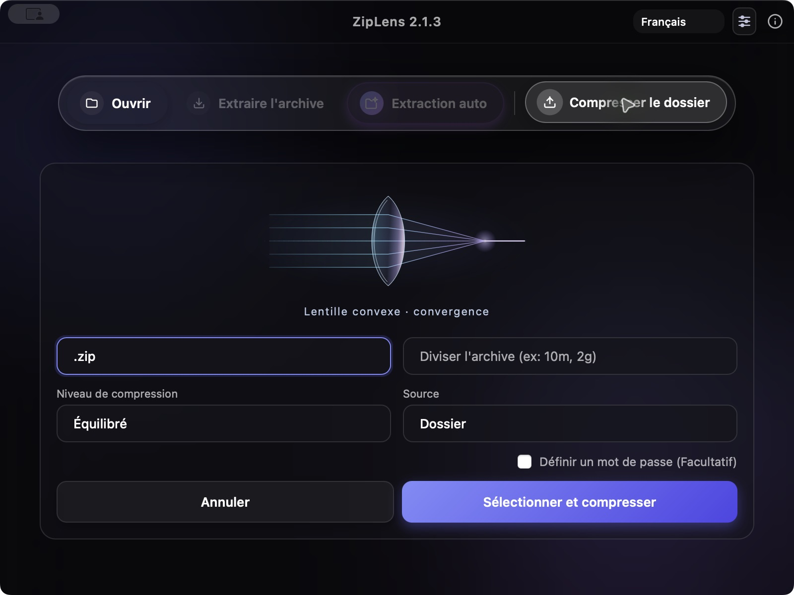

# ZipLens

**[한국어](ZipLens_Astra/docs/guides/ko.md) · [English](ZipLens_Astra/docs/guides/en.md) · [Español](ZipLens_Astra/docs/guides/es.md) · [Français](ZipLens_Astra/docs/guides/fr.md) · [Deutsch](ZipLens_Astra/docs/guides/de.md) · [Русский](ZipLens_Astra/docs/guides/ru.md) · [简体中文](ZipLens_Astra/docs/guides/zh.md)**

[日本語](ZipLens_Astra/docs/guides/ja.md) · [Tiếng Việt](ZipLens_Astra/docs/guides/vi.md) · [العربية](ZipLens_Astra/docs/guides/ar.md)

**풀기 전에 확인하고, 필요한 파일만 꺼내세요.** ZipLens는 무료·광고 없는 macOS 압축 앱입니다. 빛을 모으고 퍼뜨리는 렌즈로 압축과 압축 해제를 표현합니다.

**ZipLens 2.1.3 · Apple Silicon 프리뷰**

[**DMG 다운로드**](https://github.com/SeederPowerDrop/ZipLens/releases/download/v2.1.3/ZipLens_2.1.3_arm64-preview.dmg) · [릴리스·소스·체크섬](https://github.com/SeederPowerDrop/ZipLens/releases/tag/v2.1.3) · [7개 언어 업데이트 안내](ZipLens_Astra/docs/RELEASE_2.1.3_MULTILINGUAL.md)


| 개발 취지·도움말·선택적 후원 | 형식과 옵션을 정해 새 압축 |
|---|---|
|  |  |

## 무엇을 할 수 있나요?

| 기능 | 사용할 때의 이점 |
|---|---|
| 목록·검색·미리보기 | 전체를 풀기 전에 내용을 살펴보고 필요한 파일만 선택합니다. |
| 다섯 생성 형식 | ZIP, 7Z, TAR, TAR.GZ, TAR.ZST를 만듭니다. GUI에서 ZIP·7Z 암호와 분할 옵션을 사용할 수 있습니다. |
| 다양한 압축 열기 | ALZ·EGG를 포함해 별칭까지 36개 확장자를 인식합니다. [형식별 한계](ZipLens_Astra/README.md#지원-범위)를 확인하세요. |
| 결과 확인과 원본 보호 | 이름 충돌을 처리하고 완료 보고서에서 실제 저장 경로와 실패 항목을 확인합니다. |
| 10개 언어와 도움말 | 앱 언어를 선택하고 **ⓘ → 사용 가이드**에서 해당 언어의 GitHub 설명서를 엽니다. 인터넷 연결이 필요합니다. |
| AI·터미널 자동화 | 같은 앱의 JSON CLI로 목록 조회·압축·해제를 실행합니다. 별도 AI 서비스나 API 키는 필요하지 않습니다. |

2.1.3은 **DMG 설치 파일과 GitHub 도움말 연결**을 추가합니다. 번역된 사용 설명서를 앱에서 바로 열고 공개 소스·변경 이력까지 함께 찾아볼 수 있습니다. 브라우저를 실행하지 못하면 내장 기본 가이드를 표시합니다. 브라우저가 열린 뒤의 네트워크 오류까지 자동으로 전환하지는 않습니다.

## 설치하고 시작하기

1. 위 DMG를 받고, 실행 중인 구버전의 작업을 마친 뒤 **⌘Q**로 종료합니다.
2. DMG를 열어 **ZipLens.app 전체를 응용 프로그램 폴더로 복사**합니다. 기존 앱을 교체한다면 먼저 백업하세요.
3. 복사한 앱을 실행하고 **ⓘ**에서 **2.1.3**을 확인합니다. 설치를 마치면 DMG 볼륨을 추출합니다.

**압축 해제:** 압축 파일을 앱에 놓기 → 필요한 항목 선택 → 압축 해제 → 저장 폴더 선택.

**새 압축:** 파일·폴더를 놓기 → 형식·옵션 선택 → 압축 → 이름과 저장 위치 선택.

> **Apple Silicon용 ad-hoc 서명·미공증 프리뷰입니다.** DMG는 앱을 담는 설치 매체이며 Apple 공증을 대신하지 않습니다. macOS가 실행을 차단할 수 있고, 다른 모든 Mac에서의 실행을 보장하지 않습니다. Intel Mac 실행은 검증하지 않았습니다. [실행 문제 안내](ZipLens_Astra/docs/MACOS_LAUNCH_KO.md) · [신뢰하는 앱의 사용자 허용 절차: Apple](https://support.apple.com/102445) · [실제 DMG·다운로드·설치 검증](ZipLens_Astra/docs/INSTALLATION_VALIDATION_2.1.3_KO_EN.md)

## 성능: 2.1.2 엔진의 기존 측정

아래 수치는 **2026-10-18의 2.1.2 CLI 검사**이며 2.1.3에서 다시 측정한 결과가 아닙니다. Apple M3·메모리 24 GiB·macOS 15.7.5, 압축 수준 6 조건입니다.

| 조건 | 관측 결과 |
|---|---|
| 4 GiB + 64 MiB 단일 파일, 약 4.36 GB | 2.1.2 ZIP 압축 **64.9초**, 해제 **8.5초**의 중앙값, 각 2회 |
| 4 KiB 파일 10,000개 | 후속 해제 중앙값 **2.1.1 0.722초 → 2.1.2 0.815초**; 약 0.093초 / 12.8% 증가 |
| 512 MiB 혼합 표본, 7Z 압축 | 프로세스 트리 RSS 샘플 최고치 약 **1.71 GiB** |

총 **40왕복은 구버전 14 + 2.1.2 26왕복**이며 이름·크기·SHA-256과 원본 보존 검사를 통과했습니다. 작은 파일의 측정 범위는 겹치며 원인은 미확정입니다. RSS는 100ms 간격의 추정치이고 속도·메모리는 입력과 환경에 따라 달라집니다. 모든 조건의 성능 개선이나 무오류를 주장하지 않습니다. [전체 표·반복 횟수·한계](ZipLens_Astra/docs/LARGE_FILE_VALIDATION_2026-10-18.md)

화면 언어와 파일명 인코딩은 별개입니다. 무태그 구형 ZIP의 CP932·GBK·CP437 이름을 항상 자동 판별할 수는 없습니다. ZIP 생성 암호는 출력 가능한 ASCII를 사용하며 Unicode 암호에는 7Z를 선택하세요.

## 우리가 추구하는 소프트웨어 기본권

누구나 경제적 여건이나 사용 언어와 관계없이 기본적인 디지털 도구를 사용하고, 코드를 공부·수정·공유하며 개발에 기여할 수 있기를 바랍니다. ZipLens는 이 **소프트웨어 기본권**을 개발의 지향점으로 삼습니다. 사람과 AI가 지식을 나누고 함께 배우며 창작할 수 있는 환경을 만들고 싶습니다.

## 라이선스와 후원

ZipLens 자체 코드는 **[GPL-3.0-only](LICENSE)**로 공개합니다. 외부 구성요소에는 각자의 라이선스를 유지하며, 실행 파일과 해당 버전의 대응 소스·빌드 자료를 함께 제공합니다. [배포·라이선스 안내](ZipLens_Astra/docs/DISTRIBUTION_KO.md)

공식 앱의 **[Buy Me a Coffee](https://buymeacoffee.com/master_chief) · [Ko-fi](https://ko-fi.com/seederpower) · Bitcoin** 후원은 선택 사항입니다. Bitcoin 주소와 QR 코드는 앱 정보창에 있습니다. 수정본에도 원작 프로젝트와 원작자 후원 링크를 남겨 주시면 감사하겠습니다. 이는 **자발적인 부탁이며 GPL의 추가 조건이 아닙니다.** 후원 없이 앱과 소스를 사용할 수 있습니다.

## 공부하고 기여하기

현재 앱은 `ZipLens_Astra/`, 저장소 루트의 기존 앱 코드는 1.x 이력입니다.

```sh
cd ZipLens_Astra
npm ci
cargo fetch --manifest-path astra-core/Cargo.toml --locked
cargo fetch --manifest-path src-tauri/Cargo.toml --locked
npm run tauri dev
```

macOS, Node.js, Rust/Cargo 1.89 이상, Python 3.11 이상과 Xcode Command Line Tools가 필요합니다.

[빌드·지원 형식](ZipLens_Astra/README.md) · [코드 읽기](ZipLens_Astra/docs/CODE_GUIDE_KO.md) · [기여 방법](ZipLens_Astra/docs/CONTRIBUTING_KO.md) · [CLI](ZipLens_Astra/docs/AI_CLI.md) · [변경 이력](ZipLens_Astra/CHANGELOG.md) · [검증 기록](ZipLens_Astra/docs/VALIDATION.md) · [문제 신고](https://github.com/SeederPowerDrop/ZipLens/issues/new)

공개 저장소에는 소스·사용법·재빌드 자료와 검증 요약을 남깁니다. 개인 개발 기록과 원시 실행 로그는 별도로 비공개 보관합니다.

## English

ZipLens is a free, ad-free macOS archive app: browse before extracting, choose only what you need, or create ZIP, 7Z, TAR, TAR.GZ and TAR.ZST archives. Version **2.1.3** adds a **DMG installer and links from Help to localized GitHub guides**. [English introduction, installation and usage](ZipLens_Astra/docs/guides/en.md)

This Apple Silicon preview is **ad-hoc signed and not Apple-notarized**. A DMG does not change that status; macOS may block it, other Macs are not guaranteed, and Intel execution is unverified. Performance figures above are historical **2.1.2 engine/CLI benchmarks**, not a 2.1.3 rerun.

### Basic software rights: our guiding value

Everyone, regardless of income or language, should be able to use basic digital tools and study, modify, share and contribute to their code. We want people and AI to share knowledge, learn and create together.

### License and support

ZipLens's own code is **GPL-3.0-only**; third-party licenses remain separate. Official donations are optional. Please retain the original project and author support links in distributed modifications as a **voluntary request, not an additional GPL condition**.

Copyright (C) 2026 SeederPowerDrop and contributors. No warranty, as described in [LICENSE](LICENSE).

그리고 ERW FWS WRG
