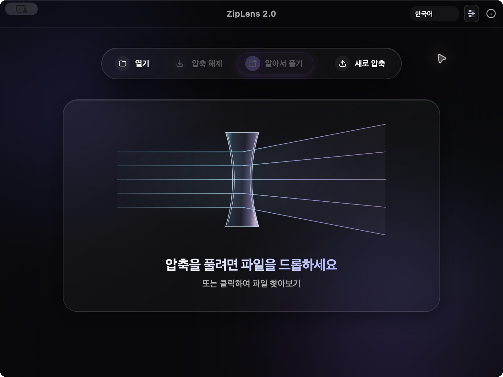
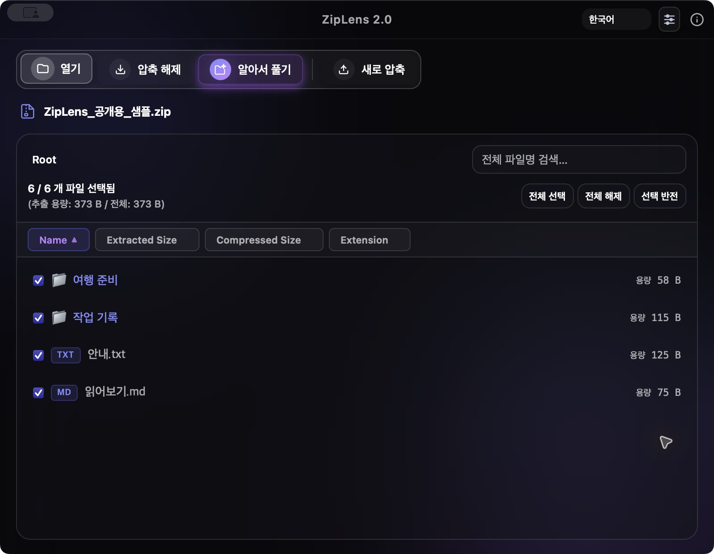

# ZipLens

첫 ZipLens를 보존하면서 안정성과 처리 속도를 개선한 독립 개발판입니다. 앱 식별자는 `com.ziplens.astra`, 표시 이름은 `ZipLens`입니다. 현재 공개 GitHub 프리뷰는 **2.1.1**입니다.

## 2.1.1 공개 프리뷰 — 2026-10-11

앱 이름을 **ZipLens**로 통일하고 정보창에 실제 버전을 한 번만 표시합니다. 사람과 AI가 기본적인 디지털 도구를 지식 공유처럼 자유롭게 사용하며 공존할 수 있기를 바라는 제작 철학을 소개합니다. 무료 사용과 광고 없는 운영을 이어가며, 유용하게 사용한 분은 선택적으로 후원할 수 있습니다. 정보창에는 [Buy Me a Coffee](https://buymeacoffee.com/master_chief)·[Ko-fi](https://ko-fi.com/seederpower)·Bitcoin(BTC) 후원과 앱에 포함된 오프라인 사용법을 모았습니다. Bitcoin은 BlueWallet의 일반 수신 주소를 복사하거나 QR 코드로 사용할 수 있습니다.

2.1.0에서 추가한 AI/CLI 기능도 그대로 포함합니다. 사람은 기존 앱 화면을 사용하고, AI와 자동화 도구는 같은 앱의 `cli` 명령으로 목록 조회·압축 해제·새 압축을 실행합니다. 창이나 대화상자를 열지 않고 JSON 결과와 종료 코드를 반환합니다. 기존 파일은 기본적으로 보존하며, 실제 생성된 경로를 결과에 포함합니다.

```sh
"/Applications/ZipLens.app/Contents/MacOS/ziplens" cli capabilities
"/Applications/ZipLens.app/Contents/MacOS/ziplens" cli list "/path/to/archive.zip"
"/Applications/ZipLens.app/Contents/MacOS/ziplens" cli extract "/path/to/archive.zip" --destination "/path/to/output"
```

공개 2.1.1 앱이나 현재 소스를 빌드한 앱에서 사용할 수 있습니다. 이번 2.1.1에는 GPLv3 적용과 대응 소스 배포를 포함합니다. [2.1.1 업데이트 안내](docs/RELEASE_2.1.1_KO_EN.md) · [사용 설명서](docs/USER_GUIDE_KO_EN.md) · [AI/CLI 사용법과 JSON 계약](docs/AI_CLI.md)

현재 2.1.1 프리뷰는 **한국어, 영어, 일본어, 중국어(간체), 베트남어, 스페인어, 프랑스어, 독일어, 러시아어, 아랍어**를 지원합니다. 앱 화면·압축 설정·정보창·후원 안내·오프라인 사용법·기본 앱 설정·사용자 정의 macOS 메뉴를 번역하며, 아랍어는 오른쪽에서 왼쪽으로 표시합니다. 저장된 언어를 우선 사용하고 처음 실행할 때는 시스템의 선호 언어 중 지원하는 언어를 선택합니다. 지원 언어가 없으면 영어로 표시합니다. macOS 자체 대화상자 버튼과 시스템 제공 메뉴 항목은 운영체제 설정을 따르며, 압축 엔진의 상세 오류 원문은 그대로 표시할 수 있습니다.

메인 화면에서 파일·폴더를 고르거나 끌어 놓으면 압축 파일은 목록을 열고, 일반 파일·폴더·혼합 선택은 새 압축 설정으로 이어집니다. 렌즈 그림을 더블클릭하면 열 가지 렌즈·빛 패턴의 개념도와 설명을 둘러볼 수 있습니다.

## 실제 이미지 검증 — 2.1.1 로컬 프리뷰

2026년 10월 10일, macOS 15.7.5의 Apple Silicon Mac에서 **DNG 728개와 HEIC 1개, 총 729개·26.58GB**를 다섯 ZIP 묶음으로 압축·해제했습니다. 모든 해제본의 파일명·크기·**SHA-256 해시가 원본과 일치**했고, 원본의 전후 해시와 검사한 파일 정보도 동일했습니다. 네 묶음은 4GiB를 넘는 ZIP64였으며, ZIP 결과 합계는 **24.94GB(약 6.2% 감소)**였습니다.

크기가 다양한 **15개·494.7MB** 표본으로 7Z·TAR·TAR.GZ·TAR.ZST 왕복 검사도 통과했습니다. 암호 ZIP의 암호 없음·오류·정상 복원, 선택 해제와 중복 파일 보존도 확인했습니다. 별도로 실행한 프런트엔드 **56개**, 앱 CLI **18개** 회귀 검사는 실패·건너뜀 없이 모두 통과했습니다.

앱 화면과 동일한 엔진을 CLI로 실행한 결과입니다. 전체 26.58GB를 하나의 압축 파일로 만드는 조건과 GUI 드래그·취소 조작은 이번 범위에 포함하지 않았습니다. [검사 조건·형식별 결과·확인 범위](docs/VALIDATION.md)

## 이전 공개 프리뷰 2.0.3에서 달라진 점 — 정보창 언어

앱의 언어를 선택하고 정보 버튼을 누르면 해당 언어로만 소개글·제목·버전 표시·후원·라이선스·닫기 버튼을 표시합니다. 한국어, 영어, 일본어, 중국어, 프랑스어, 스페인어, 아랍어를 지원하며 아랍어는 오른쪽에서 왼쪽으로 읽는 방향을 적용합니다. 개인 메시지 `ERW FWS WRG`는 그대로 유지합니다.

[이전 2.0.3 프리뷰 다운로드](https://github.com/SeederPowerDrop/ZipLens/releases/tag/v2.0.3) · [당시 한국어·영어 업데이트 안내](docs/RELEASE_2.0.3_KO_EN.md)

> Apple Silicon용 프리뷰이며 로컬 ad-hoc 서명만 적용했습니다. Apple Developer ID 서명·공증은 완료하지 않아 macOS가 실행을 차단할 수 있습니다.

## 앱 화면

**메인 화면**



**압축 파일 미리보기와 선택 해제**



2.0.2의 실제 macOS 앱에서 공개용 샘플 자료로 촬영한 화면입니다. 현재 2.1.1의 메인 화면과 정보창을 촬영한 이미지는 아닙니다.

## 이전 2.0.2에서 달라진 점

- 압축 파일을 열면 툴바와 파일 제목을 작게 표시해 내부 목록을 더 넓게 볼 수 있습니다.
- 폴더 경로·검색·선택 버튼·정렬을 목록 위에 모으고 파일 목록은 따로 스크롤합니다. 작은 창에서는 버튼 배치를 조정합니다.
- 긴 파일명은 화면 너비에 맞춰 줄여 표시하며 마우스를 올리면 전체 이름을 확인할 수 있습니다. 폴더 경로는 키보드로 이동할 수 있는 버튼으로 바꿨습니다.
- 언어를 바꿔도 열어 둔 압축 파일명이 유지되며 검색 입력의 접근성 설명도 함께 번역됩니다.
- 목록을 열 때 불필요한 화면 숨김·다시 표시와 애니메이션을 정리해 표시 안정성을 개선했습니다.

[스크린샷과 한국어·영어 업데이트 안내](docs/RELEASE_2.0.2_KO_EN.md)

## 이전 2.0.1의 실행 오류 수정

앱이 꺼진 상태에서 Finder로 압축 파일을 열 때 창을 중복 생성해 종료되던 문제를 수정했습니다. 초기 파일 요청은 창 준비가 끝날 때까지 보관합니다. 배포 검사도 실제 ZIP 압축 해제 후 서명 확인까지 수행하며, 정식 배포는 Developer ID 서명·Apple 공증·Gatekeeper 허용이 모두 필요합니다. [진단 결과와 배포 방법](docs/MACOS_LAUNCH_KO.md)

## 먼저 보기

- [2.1.1 프리뷰 다운로드](https://github.com/SeederPowerDrop/ZipLens/releases/tag/v2.1.1) · [2.1.1 업데이트 안내](docs/RELEASE_2.1.1_KO_EN.md)
- [2.1.1 사용 설명서 · 한국어 / English](docs/USER_GUIDE_KO_EN.md)

- [이전 2.0.3 프리뷰 다운로드](https://github.com/SeederPowerDrop/ZipLens/releases/tag/v2.0.3) — Apple Silicon용. 로컬 ad-hoc 서명이며 Apple 공증 미완료로 macOS 실행 차단은 남을 수 있습니다.
- [이전 2.0.3 업데이트 안내 · 한국어 / English](docs/RELEASE_2.0.3_KO_EN.md)
- [이전 2.0.2 업데이트 안내 · 한국어 / English](docs/RELEASE_2.0.2_KO_EN.md)
- [이전 2.0.1 실행 오류 수정 안내](docs/RELEASE_2.0.1_KO.md)
- [기존 2.0.0 프리뷰·고객 안내](https://github.com/SeederPowerDrop/ZipLens/releases/tag/v2.0.0) — Apple Silicon용, 시작 오류 및 Apple 공증 미완료
- [2.0.0에서 추가한 기능](docs/RELEASE_2.0.0_KO.md)

- [변경 이력](CHANGELOG.md)
- [검증 기록](docs/VALIDATION.md)
- [배포·라이선스 안내](docs/DISTRIBUTION_KO.md)

## ZipLens의 주요 개선점

- 압축 해제는 오목렌즈를 통과해 퍼지는 빛, 압축은 볼록렌즈를 통과해 모이는 빛으로 표현합니다. 실제 작업 중에만 광선이 움직이며 macOS 동작 줄이기를 지원합니다.
- 두 완료창도 같은 렌즈 디자인을 사용합니다. 알아서 풀기는 폴더와 반짝임 아이콘으로 표현합니다.
- 정보창은 현재 앱 언어로 소개글·버전·후원·사용법·라이선스 안내를 표시하고 아랍어 읽기 방향도 함께 바뀝니다. 개인 메시지 ERW FWS WRG는 그대로 유지합니다.

- 덮어쓰기 시 기존 폴더 전체를 삭제하지 않습니다. 새 데이터를 임시 폴더에서 검증하고, 같은 파일만 교체합니다.
- 상대 경로 탈출, 절대 경로, 외부 심볼릭 링크, 파일명 충돌을 검사합니다. ZIP 파일명과 오류 메시지는 HTML로 실행되지 않습니다.
- ZIP 중앙 목록을 파일마다 다시 파싱하던 병목을 제거했습니다. 실제 측정 조건과 한계는 성능 보고서에 적었습니다.
- 압축 정도를 빠르게/균형/최대로 선택합니다. 암호 없는 ZIP도 분할 압축이 적용됩니다.
- 작업 취소, 검색, 300행 단위 페이지 이동, 언어 설정 저장, 한글 ZIP 파일명 처리, 정확한 중복 파일 결과 경로를 지원합니다.
- 암호가 틀렸을 때 다시 입력할 수 있고, 메모리 미리보기는 백엔드에서도 20 MiB로 제한합니다.
- 유지보수가 중단된 `sevenz-rust`를 제거했습니다. 공식 7-Zip 26.03을 동봉하고 배포 파일 해시를 기록했습니다.

## macOS 기본 압축 해제 앱

앱 오른쪽 위의 **기본 압축 앱 설정** 버튼 또는 **ZipLens → 기본 압축 앱 설정…** 메뉴(⌘,)에서 확장자를 선택하고 적용합니다. 선택한 종류의 파일을 Finder에서 더블클릭하면 ZipLens 미리보기가 열립니다. 실행할 `.app`을 계속 사용할 위치에 둔 뒤 설정하세요. 개발 서버 실행에서는 시스템 연결을 적용하지 않습니다.

이 설정은 파일을 여는 앱을 지정합니다. Finder의 우클릭 **압축** 메뉴를 바꾸지는 않습니다. 설정을 열기만 해서는 연결이 바뀌지 않으며, 이미 기본인 확장자의 체크를 해제해도 기존 연결을 되돌리지는 않습니다. macOS에서 같은 파일 종류로 묶은 별칭은 함께 적용될 수 있습니다. ISO/DMG와 범용 분할 파일 `.001`은 열기를 지원하되 일괄 기본 연결에서는 제외합니다.

Finder에서도 파일 선택 → **정보 가져오기(⌘I) → 다음으로 열기 → ZipLens → 모두 변경**으로 종류별 기본 앱을 지정할 수 있습니다. [Apple 안내](https://support.apple.com/en-euro/guide/mac-help/mh35597/mac)

## 지원 범위

직접 만드는 포맷: ZIP, 7Z, TAR, TAR.GZ, TAR.ZST. ZIP/7Z는 암호와 분할 압축을 지원합니다. 7Z 암호 설정 시 파일 목록도 암호화합니다. ZIP의 기본 암호화는 AES-256입니다.

열기·미리보기·압축 해제의 연결 목록은 36개 확장자입니다(서로 같은 형식의 별칭 포함).

- 일반 압축: ZIP, ZIPX, 7Z, RAR, TAR.
- ALZ·EGG: 목록, 선택 해제와 파일 미리보기(해제 전용).
- 스트림/압축 TAR: GZ/GZIP, TGZ, BZ2/BZIP2, TBZ/TBZ2, XZ/TXZ, ZST/ZSTD/TZST, LZMA, Z. `tar.gz`, `tar.bz2`, `tar.xz`, `tar.zst` 등은 내부 TAR의 파일까지 열고 선택해 해제합니다.
- 추가 아카이브: CAB, LZH/LHA, ARJ, CPIO, AR, XAR, WIM.
- 만화 파일 별칭: CBZ, CBR, CB7, CBT.
- 디스크 이미지/분할 파일: ISO, DMG, 001(첫 조각, 나머지 조각은 같은 폴더에 필요).

ZIP과 TAR 목록/해제 검증은 Rust 엔진을 사용합니다. 추가 압축 스트림과 7Z 등은 동봉한 7-Zip을 사용합니다. 파일 종류마다 지원하는 압축 방식과 변종에는 차이가 있습니다. 특히 RAR/ISO/DMG/CAB 등의 모든 변종을 직접 검증했다는 의미는 아닙니다. 실제 회귀 검사 범위는 [검증 기록](docs/VALIDATION.md)에 남깁니다. ALZ·EGG는 별도 보조 프로그램에서 처리하며 안전 한도를 초과하거나 손상된 파일은 완료로 처리하지 않습니다. EGG의 암호화된 파일명·전체 헤더 등 일부 변형은 지원하지 않으며 [크기 한도와 검증 범위](astra-core/tests/fixtures/legacy/README.md)를 확인할 수 있습니다. [공식 7-Zip 형식 안내](https://www.7-zip.org/)

TAR의 암호/분할 옵션은 명시적으로 오류를 표시합니다. 7-Zip 경로의 링크는 현재 차단합니다. macOS 앱 번들의 리소스 포크·확장 속성·서명 보존은 추가 검증이 필요합니다.

## 실행과 빌드

macOS, Node.js, Rust/Cargo 1.89 이상(검증 버전 1.94.0), Xcode Command Line Tools, Python 3.11 이상이 필요합니다. 이 작업에서는 Apple M3, 메모리 24 GiB, macOS 15.7.5에서 확인했습니다. Rust 도구 버전이나 의존성을 바꿨다면 `python3 scripts/generate-third-party-notices.py`로 고지를 갱신하고 변경된 조건을 검토하세요.

```sh
cd ZipLens_Astra
npm ci
cargo fetch --manifest-path astra-core/Cargo.toml --locked
cargo fetch --manifest-path src-tauri/Cargo.toml --locked
npm run tauri dev
```

로컬에서 실행할 최적화 프리뷰 만들기:

```sh
npm run tauri build -- --bundles app
python3 scripts/package-macos.py --preview
```

로컬 작업 폴더에서 바로 실행할 앱: `release_build/preview/ZipLens.app`.
직접 다시 빌드하면 `src-tauri/target/release/bundle/macos/ZipLens.app`에 생성됩니다.
`release_build`와 빌드 산출물은 Git에 포함되지 않으므로 새로 clone한 환경에서는 위 명령으로 빌드해야 합니다.
`--preview`는 앱과 보조 프로그램에 로컬 ad-hoc 서명을 추가하고, ZIP을 실제로 풀어 파일 내용·실행 권한·서명을 검사합니다. 프리뷰는 Apple 공증을 받은 공개 배포판이 아니며 다운로드 후 실행이 차단될 수 있습니다. 정식 결과물과 섞이지 않도록 `release_build/preview`에 저장합니다.

정식 배포는 기존 키체인의 **Developer ID Application 인증서와 개인 키**, **notarytool 프로필**을 준비한 뒤 실행합니다. 인증서와 프로필 이름은 실제 설정으로 바꾸세요.

```sh
python3 scripts/package-macos.py \
  --signing-identity "Developer ID Application: YOUR NAME (TEAMID)" \
  --notary-profile "YOUR_NOTARY_PROFILE"
```

인증서 검증, 보조 프로그램·앱 서명, Apple 공증 승인, 공증 티켓 첨부, 최종 ZIP 압축 해제 후 Gatekeeper 검사를 모두 통과해야 `release_build`에 정식 파일을 생성합니다. 인증서가 없거나 검증이 실패하면 중단하며 임시 서명으로 대신 배포하지 않습니다. `SHA256SUMS.txt`와 `packaging-result.json`도 함께 생성합니다.

## 검증 명령

Dock 아이콘의 원본은 흰 바깥 여백을 제거한 투명 `app-icon.png`입니다. `app-icon.jpg`는 이전 디자인 참고용으로 보존합니다. 아이콘을 갱신할 때는 `npm run tauri -- icon app-icon.png --output /tmp/ziplens-icons`로 변환한 뒤, 출력 폴더 최상위의 PNG·ICNS·ICO 파일을 `src-tauri/icons/`에 복사하고 `icon.png`를 `public/app-icon.png`에도 복사하세요. 모바일용 하위 폴더는 현재 데스크톱 앱에서 사용하지 않습니다.

```sh
npm test
python3 scripts/test-package-macos.py
python3 scripts/test-cli.py --binary "release_build/preview/ZipLens.app/Contents/MacOS/ziplens"
npm run build
cargo test --manifest-path src-tauri/Cargo.toml --lib --locked
cargo test --manifest-path astra-core/Cargo.toml --locked
cargo clippy --manifest-path astra-core/Cargo.toml --all-targets --locked -- -D warnings
```

선택적 성능 시험(자신의 환경에서 결과 파일 생성):

```sh
cargo run --manifest-path astra-core/Cargo.toml --example benchmark --release --locked -- /tmp/ziplens-benchmark-results.json
```

빌드 전에 `scripts/prepare-distribution.py`가 동봉된 공식 7-Zip 배포 파일·소스의 해시와 라이선스 자료를 확인하고, ALZ·EGG 해제 보조 프로그램을 빌드합니다. 라이선스 자료가 누락되거나 의존성 변경 후 갱신되지 않았으면 빌드를 중단합니다. 원본 프로젝트의 의존성이나 빌드 폴더를 공유하지 않습니다. 두 Rust lockfile은 각 명령의 재현성을 위해 유지합니다.

현재 소스를 포장하면 로컬 프리뷰 ZIP은 `release_build/preview/ZipLens_2.1.1_arm64-preview.zip`입니다. 서명·공증을 완료한 정식 ZIP의 경로는 `release_build/ZipLens_2.1.1_arm64.zip`입니다. 공개 다운로드는 [2.1.1 프리뷰 릴리스](https://github.com/SeederPowerDrop/ZipLens/releases/tag/v2.1.1)에서 받을 수 있습니다. 현재 게시본은 프리뷰이며 정식 서명·공증 완료를 의미하지 않습니다.

같은 릴리스의 `ZipLens_2.1.1_source.tar.gz`에는 이 배포본의 전체 자체 소스와 빌드 안내, 실행·빌드에 쓰이는 Rust crate 소스, npm 의존성의 상위 프로젝트 TypeScript 소스 아카이브가 포함됩니다. 직접 빌드를 재현할 때 참고하세요. 공개 문서에는 검증 요약을 남기고 개인 작업 기록과 원시 실행 로그는 별도로 비공개 보관합니다.

## 라이선스와 후원

현재 저장소의 ZipLens 자체 소스 코드는 **GNU General Public License version 3만 적용하는 `GPL-3.0-only`**로 공개합니다. 누구나 코드를 공부하고 수정하며 기여할 수 있습니다. 전체 조건은 [LICENSE](LICENSE)에 있습니다. 7-Zip과 다른 외부 구성요소에는 각각의 라이선스가 적용되며, [구성요소별 라이선스 고지](legal/)를 함께 확인해 주세요.

Copyright (C) 2026 SeederPowerDrop and contributors. GPLv3에 명시된 대로 이 프로그램에는 보증이 없습니다. [앱 라이선스 안내](legal/ziplens/NOTICE.txt)를 참고하세요. 기존 공개 2.0.3 배포 파일은 이번 소스 변경으로 갱신되지 않습니다.

원본이나 수정본을 배포할 때에는 GPLv3의 저작권·라이선스 고지 및 변경 표시 조건을 따라야 합니다. 실행 파일을 배포하면 수령인이 해당 버전의 대응 소스 코드를 GPLv3에 따라 받을 수 있도록 해야 합니다. 배포하지 않고 개인적으로 수정해 사용하는 것만으로 소스를 공개할 의무가 생기지는 않습니다.

공식 앱의 후원란은 계속 유지합니다. 원작자의 개발을 응원하고 싶다면 [Buy Me a Coffee](https://buymeacoffee.com/master_chief) 또는 [Ko-fi](https://ko-fi.com/seederpower)를 이용할 수 있습니다. 앱 사용이나 소스 코드 이용에 후원은 필요하지 않습니다.

**수정본을 배포하시는 분께 부탁드립니다.** 누구나 배우고 개선할 수 있도록 공개한 [원작 ZipLens 프로젝트](https://github.com/SeederPowerDrop/ZipLens)와 원작자 SeederPowerDrop의 위 후원 링크를 수정본의 정보란이나 README에도 남겨 주시면 감사하겠습니다. 이는 지속적인 개발을 위한 **자발적인 협조 요청이며, GPLv3에 추가되는 라이선스 조건이 아닙니다.**

## English

**Public preview 2.1.1 — October 11, 2026.** The app is now named **ZipLens** (`ZipLens.app`), with the actual version shown once in About. The introduction describes a commitment to making basic digital tools freely available to people and AI, in the spirit of shared knowledge and coexistence. About brings together optional [Buy Me a Coffee](https://buymeacoffee.com/master_chief), [Ko-fi](https://ko-fi.com/seederpower) and Bitcoin support, plus a bundled offline user guide. Bitcoin uses the ordinary receiving address from BlueWallet, with copy and QR options. The app remains free and ad-free.

The headless `cli` interface introduced in 2.1.0 remains available for AI agents and terminal automation: `capabilities`, `list`, `extract`, and `compress`. It returns JSON and exit codes, preserves existing files by default, and reports actual output paths. See the [CLI contract and examples](docs/AI_CLI.md). Version 2.1.1 adds GPLv3 licensing and a matching source archive. [2.1.1 release notes](docs/RELEASE_2.1.1_KO_EN.md) · [User guide](docs/USER_GUIDE_KO_EN.md)

The home screen routes selected or dropped archives to browsing, and regular files, folders or mixed selections to compression settings. Double-click its lens illustration to explore ten conceptual lens and beam exhibits with explanations.

### Real-image validation of local preview 2.1.1

On October 10, 2026, we compressed and extracted **729 real images totaling 26.58GB**—728 DNG files and one HEIC—in five ZIP batches on an Apple Silicon Mac running macOS 15.7.5. Every restored filename, size and **SHA-256 hash matched the original**. Source hashes and the checked file attributes also remained unchanged. Four batches exercised ZIP64 beyond 4GiB; the combined ZIP output was **24.94GB, a reduction of about 6.2%** for this corpus.

A varied **15-image, 494.7MB** sample also passed round-trip checks in 7Z, TAR, TAR.GZ and TAR.ZST. Tests covered missing, incorrect and correct encrypted-ZIP passwords, selective extraction, and preserving existing files with conflicting names. All **56 frontend** and **18 app CLI** regression tests passed without failures or skips.

These checks ran the same archive engine used by the app through its CLI. A single 26.58GB archive and GUI drag-and-drop or cancellation interactions were outside this run's scope. [Conditions, per-format results and scope](docs/VALIDATION.md)

### Earlier public preview 2.0.3

**Version 2.0.3 introduced this change:** About began showing only the selected app language, including its title, introduction, version label, support and license controls, and close buttons. That version supported Korean, English, Japanese, Chinese, French, Spanish, and Arabic, including RTL layout for Arabic. The personal message `ERW FWS WRG` is preserved.

**ZipLens 2.0.3** was the previous public preview of this free macOS archive utility for previewing archives, extracting selected files, and creating ZIP, 7Z, TAR, TAR.GZ, and TAR.ZST files. ZIP/7Z support passwords and split archives. ALZ and EGG support listing, previews, and extraction through a dedicated helper; they are extraction-only formats. The app recognizes 36 extensions, including aliases.

[Earlier 2.0.3 Apple Silicon preview](https://github.com/SeederPowerDrop/ZipLens/releases/tag/v2.0.3) · [Bilingual update and screenshots](docs/RELEASE_2.0.3_KO_EN.md)

Previous version 2.0.2 gave archive contents more room with a compact toolbar and archive title, grouped search and selection controls, and a separately scrolling file list. Long filenames have full-name hover text, folder breadcrumbs are keyboard-accessible buttons, and changing languages preserves the open archive's name. That update also simplified display transitions after loading. The Finder startup crash fixed in 2.0.1 remains fixed.

The 2.0 series also improves original-file protection, Korean ZIP filenames, password retries, cancellation, and multi-file ZIP extraction. The current 2.1.1 preview supports Korean, English, Japanese, Simplified Chinese, Vietnamese, Spanish, French, German, Russian, and Arabic. Saved language preferences take priority; otherwise the app chooses the first supported system language, falling back to English. App controls, About and support copy, the offline user guide, default-app settings, and custom macOS menu titles are localized. OS-provided controls follow macOS, and detailed backend diagnostics may remain in their original language. The screenshots above were captured from the 2.0.2 macOS app with public sample files; they do not depict the updated About window in 2.0.3 or the current 2.1.1 interface and ten languages.

**This is an Apple Silicon preview with a local ad-hoc signature, without Apple Developer ID signing or notarization. macOS may still block it from opening.** Intel execution and every archive variant have not been verified. Encrypted EGG filenames/full headers are unsupported, and complete preservation of macOS app-bundle metadata remains unverified. See the [validation history](docs/VALIDATION.md) and [launch diagnosis](docs/MACOS_LAUNCH_KO.md) for details.

To build, install Node.js, Rust/Cargo 1.89 or later, Python 3.11 or later, and Xcode Command Line Tools on macOS, then run:

```sh
cd ZipLens_Astra
npm ci
npm run tauri build -- --bundles app
python3 scripts/package-macos.py --preview
```

The current source produces `release_build/preview/ZipLens.app` and `release_build/preview/ZipLens_2.1.1_arm64-preview.zip`. Build outputs are not tracked in Git. The packaging process checks extracted file contents, executable permissions, and local signatures. A formal release additionally requires a valid Developer ID identity, an existing notarization profile, and successful notarization and Gatekeeper checks; local preview signing does not satisfy these requirements.

The [2.1.1 release](https://github.com/SeederPowerDrop/ZipLens/releases/tag/v2.1.1) provides `ZipLens_2.1.1_source.tar.gz` with the complete matching first-party source, build instructions, runtime/build Rust crate sources and upstream TypeScript source archives for npm dependencies to help reproduce the build. Public docs retain validation summaries; personal work records and raw run logs are kept separately in a private archive.

### License and support

ZipLens's own source code in the current repository is licensed under the **GNU General Public License, version 3 only (`GPL-3.0-only`)**. You are welcome to study, modify and contribute to it. See [LICENSE](LICENSE) for the full terms. 7-Zip and other third-party components retain their respective licenses; see the [component license notices](legal/).

Copyright (C) 2026 SeederPowerDrop and contributors. This program comes without warranty as described in GPLv3; see the [app license notice](legal/ziplens/NOTICE.txt). This source change does not update the existing public 2.0.3 release files.

Distribution of original or modified copies must follow GPLv3's copyright, license notice and change-marking requirements. When distributing executables, make the corresponding source for that version available to recipients as required by GPLv3. Private modifications that you do not distribute do not require public source disclosure.

The official app keeps its support section. You can support the original author's development through [Buy Me a Coffee](https://buymeacoffee.com/master_chief) or [Ko-fi](https://ko-fi.com/seederpower). Donations are optional and are not required to use the app or its source code.

**A request to distributors of modified versions:** please keep a link to the [original ZipLens project](https://github.com/SeederPowerDrop/ZipLens) and the original author SeederPowerDrop's support links above in your About screen or README. This is a **voluntary request to support continued development, not an additional license condition under GPLv3**.
