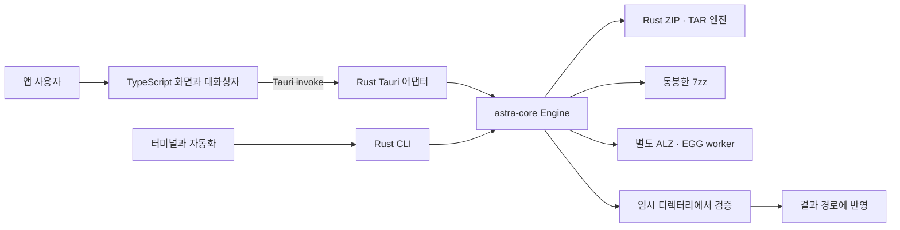
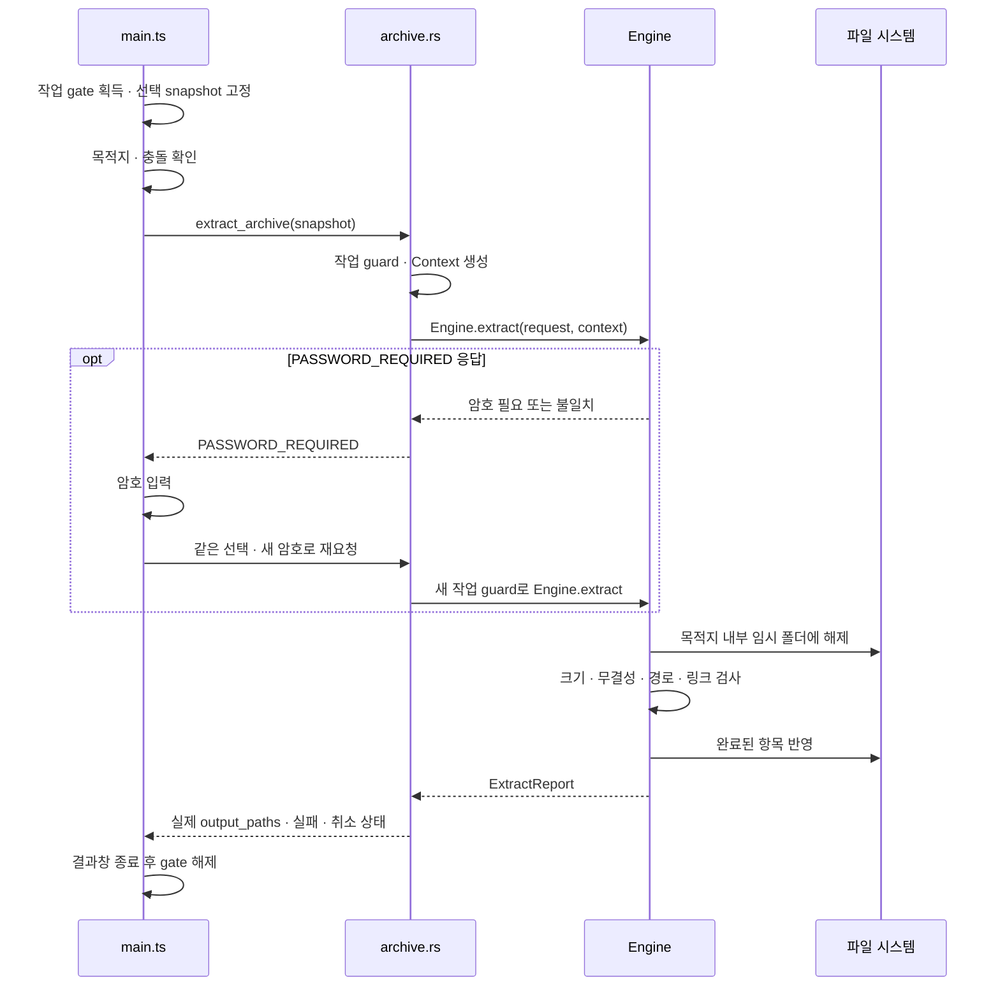

# ZipLens 코드 읽기 안내

ZipLens를 처음 공부하거나 다음 업데이트를 맡는 개발자를 위한 안내입니다. **현재 앱은 `ZipLens_Astra/`에 있습니다.** 이 문서는 2.1.1 이후의 유지보수 소스를 설명하며, 이미 배포한 `v2.1.1` 실행 파일을 새로 바꿨다는 뜻은 아닙니다. 실행·검증 방법은 [기여 및 업데이트 안내](CONTRIBUTING_KO.md), 사용자 동작은 [사용 설명서](USER_GUIDE_KO_EN.md)를 함께 보세요.

문서의 코드 경로는 별도 표시가 없으면 `ZipLens_Astra/` 기준입니다. 함수 이름을 편집기의 심볼 검색으로 찾으면 줄 번호가 바뀌어도 따라갈 수 있습니다.

## 1. 두 프로젝트와 네 가지 역할

저장소 루트의 `src/`, `src-tauri/`, `package.json`은 보존된 **1.x 프로젝트**입니다. 현재 앱을 고칠 때 루트의 동명 파일을 수정하거나 루트에서 `npm run tauri dev`를 실행하지 않도록 먼저 작업 위치를 확인하세요. `ZipLens_Astra`, `astra-core`, `com.ziplens.astra`는 개발 폴더·crate·앱 식별자입니다. 사용자에게 보이는 제품 이름은 **ZipLens**이며, 내부 이름을 보기 좋게 바꾸는 것만으로도 설치 설정·빌드 경로·연결이 달라질 수 있습니다.

| 역할 | 읽을 파일 | 맡는 일 |
|---|---|---|
| 화면과 사용자 흐름 | [`src/main.ts`](../src/main.ts), [`src/ui.ts`](../src/ui.ts), [`index.html`](../index.html) | 이벤트·선택 상태·대화상자·IPC 호출을 연결합니다. 압축 알고리즘은 두지 않습니다. |
| 순수 화면 모델 | [`src/archive-model.ts`](../src/archive-model.ts), [`src/input-routing.ts`](../src/input-routing.ts), [`src/report-model.ts`](../src/report-model.ts) | 선택 고정·입력 분류·보고서 데이터와 내보내기를 담당합니다. DOM이나 Tauri 없이 시험할 수 있습니다. |
| macOS / Tauri 어댑터 | [`src-tauri/src/archive.rs`](../src-tauri/src/archive.rs), [`src-tauri/src/lib.rs`](../src-tauri/src/lib.rs) | 작업 잠금, 백그라운드 실행, 진행률 이벤트, 앱 창·Finder·메뉴를 연결합니다. |
| GUI 없는 실행 | [`src-tauri/src/main.rs`](../src-tauri/src/main.rs), [`src-tauri/src/cli.rs`](../src-tauri/src/cli.rs) | 창을 만들기 전에 CLI를 판별하고 입력 검증·JSON·종료 코드를 담당합니다. |
| 공통 엔진 | [`astra-core/src/lib.rs`](../astra-core/src/lib.rs) | `Engine`, `Entry`, `ExtractRequest`, `ExtractReport`를 정의하고 형식별 엔진과 결과 반영을 조합합니다. |
| 코덱과 보조 실행 파일 | [`zip_engine.rs`](../astra-core/src/zip_engine.rs), [`tar_engine.rs`](../astra-core/src/tar_engine.rs), [`sidecar.rs`](../astra-core/src/sidecar.rs), [`legacy.rs`](../astra-core/src/legacy.rs) | Rust ZIP/TAR, 7-Zip, ALZ/EGG worker 경로를 나눕니다. |
| 빌드와 배포 | [`src-tauri/tauri.conf.json`](../src-tauri/tauri.conf.json), [`scripts/prepare-distribution.py`](../scripts/prepare-distribution.py), [`scripts/package-macos.py`](../scripts/package-macos.py) | 화면 빌드, 보조 프로그램 준비, 고지 검증, 앱 포장과 서명을 담당합니다. |

`astra-core`는 Tauri에 의존하지 않습니다. GUI와 CLI에서 동일한 파일 보호 규칙을 적용할 수 있고, 창을 띄우지 않고 엔진을 검사할 수 있는 이유입니다. 반대로 형식에 따라 별도 실행 파일이 필요하므로 앱의 `ziplens` 실행 파일 하나만 복사해서는 모든 기능이 동작하지 않습니다.

## 2. 처음 읽을 순서

1. [`package.json`](../package.json)과 [`tauri.conf.json`](../src-tauri/tauri.conf.json): 실행 명령, 화면 진입점, 동봉 파일, 확장자 목록을 확인합니다. `npm run build`는 화면만 빌드하고, `npm run tauri build -- --bundles app`이 macOS 앱을 만듭니다.
2. [`archive-model.ts`](../src/archive-model.ts)의 `snapshotExtraction`, [`input-routing.ts`](../src/input-routing.ts)의 `classifyInputPaths`: 파일 선택이 실제 요청으로 바뀌는 작은 함수를 읽습니다. [`action-session.test.ts`](../tests/action-session.test.ts)의 snapshot 사례, [`ui-model.test.ts`](../tests/ui-model.test.ts)의 경로 사례, [`input-routing.test.ts`](../tests/input-routing.test.ts)가 동작 예제입니다.
3. [`main.ts`](../src/main.ts)의 `runArchiveAction`, `routeInputs`, `executeArchivePreview`, `executeExtraction`, `startCompression`, `executeCompression`: 한 번의 사용자 행동을 따라갑니다. 파일 전체를 처음부터 외우기보다 한 흐름만 추적하세요.
4. [`archive.rs`](../src-tauri/src/archive.rs)의 `begin_archive_operation`, `ArchiveOperationGuard`, `preview_archive`, `extract_archive`, `compress_archive`: 화면 요청이 Rust 요청 타입으로 바뀌는 곳을 봅니다.
5. [`astra-core/src/lib.rs`](../astra-core/src/lib.rs)의 `Engine::preview`, `Engine::extract`, `Engine::read_entry`, [`compress.rs`](../astra-core/src/compress.rs)의 `Engine::compress`: 형식 분기와 임시 작업·검증·반영 순서를 봅니다. 내부의 `extract_to_staging_and_publish` → `validate_staged_tree` → `publish_staged_entries`라는 이름도 이 순서를 드러냅니다.
6. [`context.rs`](../astra-core/src/context.rs), [`paths.rs`](../astra-core/src/paths.rs): 취소·진행률·크기 한도와 경로·원본 보호 규칙을 읽습니다. 이후 ZIP/TAR 구현과 보조 프로그램으로 내려갑니다.
7. [`cli.rs`](../src-tauri/src/cli.rs)와 [`AI_CLI.md`](AI_CLI.md): 같은 엔진을 다른 사용자 인터페이스로 제공할 때 유지해야 할 계약을 확인합니다.

Rust의 `Result<T, String>`은 성공 값 또는 오류 메시지를 반환합니다. `?`는 오류를 호출자에게 돌려보내므로, 어떤 자원이 그 시점에 정리되는지도 함께 읽어야 합니다. `TempDir`는 소유자가 사라질 때 임시 폴더를 정리하고, `ArchiveOperationGuard`는 `Drop`에서 현재 작업 등록을 해제합니다. 이 자동 정리를 우회하는 조기 반환이나 소유권 이동을 추가하지 않도록 주의하세요.

## 3. 목록·해제·압축을 따라가기

### 목록과 파일 미리보기

`main.ts`의 파일 선택·드래그·시작 요청은 `runArchiveAction`을 거칩니다. `routeInputs`는 Rust의 [`inspect_input_paths`](../src-tauri/src/input.rs)로 실제 파일/폴더 정보를 얻은 뒤 `classifyInputPaths`로 분류합니다. 이름이 `sample.zip`인 **폴더**를 압축 파일로 잘못 열지 않기 위한 순서입니다. 압축 파일만 여러 개 선택하면 첫 번째 파일을 열고 개수를 안내하며, 일반 파일·폴더가 섞이면 선택한 것들을 새 압축의 입력으로 유지합니다.

압축 파일은 `executeArchivePreview` → IPC `preview_archive` → `Engine::preview` 순서로 목록을 읽습니다. 압축 스트림은 [`stream.rs`](../astra-core/src/stream.rs)에서 먼저 준비될 수 있습니다. ZIP/TAR/ALZ·EGG/7-Zip 분기 뒤에는 `paths::validate_entries`로 이름과 크기·충돌을 검증합니다. 화면은 받은 목록을 선택·검색·폴더 이동에 사용합니다.

목록 조회와 파일 내용 읽기는 다른 작업입니다. `extract_file_memory` → `Engine::read_entry`는 작은 파일의 내용을 메모리로 읽으며 백엔드 한도는 **20 MiB**입니다. 외부 앱으로 여는 `prepare_external_preview`는 선택 파일을 임시 폴더로 풀고 `PreviewSessions`가 앱 종료까지 폴더를 보관합니다. 메모리 미리보기 한도를 외부 미리보기 전체에 동일하게 적용한다고 해석하면 안 됩니다.

### 선택 해제

`snapshotExtraction`은 대화상자를 기다리기 **전에** 압축 경로·암호·선택 항목·최상위 항목을 복사합니다. 기다리는 동안 Finder에서 다른 파일이 들어와도 이전 요청의 대상이 바뀌어서는 안 됩니다. `targetFiles: null`은 전체 선택을 뜻하며, 빈 선택과 같지 않습니다. 코어의 `targets`는 정확한 항목 이름 목록입니다. 폴더 이름 하나가 하위 파일까지 자동 확장되는 계약은 아닙니다.

`executeExtraction`은 예상 충돌을 먼저 확인하고 사용자 결정을 받지만, 최종 경로 검사는 코어가 다시 맡습니다. 충돌 확인과 쓰기 사이에 파일 시스템이 달라질 수 있기 때문입니다. 보고서는 요청한 경로를 추측하지 않고 `output_paths`를 사용합니다. 이름을 바꿔 보존한 결과나 일부 실패를 정확히 알려 주는 근거입니다.

### 결과 보고서와 내보내기

[`report-model.ts`](../src/report-model.ts)의 `buildReportRows`는 원본 크기를 한 번 인덱싱하고, 성공 항목에 Core의 실제 `output_paths`를 연결합니다. 파일명 접미사로 찾으면 `a.txt`와 `nested/a.txt`가 섞이고 대량 목록은 반복 전체 검색으로 느려집니다. 이름 보존 모드에서는 최상위 이름이 바뀔 수 있어 원본 크기를 추측하지 않고 `null`로 두며, TXT·CSV에서는 `-`로 표시합니다.

`reportDisplayItems`는 화면에 보여 줄 50개와 나머지 개수만 반환합니다. `formatReportTxt`·`formatReportCsv`는 이 요약 대신 전체 보고서 행을 받습니다. [`report-model.test.ts`](../tests/report-model.test.ts)는 경로 대응·전체 내보내기·100,000건의 선형 접근을, [`report-dialog.test.ts`](../tests/report-dialog.test.ts)는 실제 결과창 함수를 모의 DOM에서 실행해 표시 제한·내보내기·닫기 대기를 확인합니다.

### 새 압축

`startCompression`은 작업 gate에 들어가 선택 경로와 `readCompressionOptions()`의 결과를 고정합니다. `executeCompression`은 저장 대화상자 → IPC `compress_archive` → `Engine::compress` → 결과창 순서로 진행합니다.

`compress.rs`는 원본 목록·출력 위치·옵션을 검증한 뒤 **출력과 같은 부모 폴더의 임시 디렉터리**에 생성합니다. 암호와 분할이 없는 ZIP은 Rust ZIP 작성기, TAR 계열은 Rust 작성기, 7Z 또는 암호·분할 ZIP은 동봉한 7-Zip을 사용합니다. 따라서 UI 선택 하나를 바꿔도 실제 실행 경로가 달라질 수 있습니다. TAR 계열의 암호·분할 옵션은 지원하지 않습니다.

완료 전 취소를 확인한 후 결과를 반영합니다. 분할 조각 반영 도중에는 조각 일부만 취소로 남기지 않도록 취소 확인을 끊고, 반영 오류가 나면 이번 작업이 만든 조각만 제거하려고 시도합니다. 모든 파일 시스템 오류에서 완전한 롤백을 보장하는 방식은 아닙니다. CLI는 그 위에 기본 중복 이름 보존 정책을 별도로 적용하며, 현재 CLI에는 분할 압축 생성 옵션이 없습니다.

## 4. 비동기 작업에서 지켜야 할 경계

| 장치 | 보호하는 시간과 범위 | 대체할 수 없는 것 |
|---|---|---|
| [`ArchiveActionGate`](../src/action-session.ts) | 파일 선택, 저장·암호·충돌 대화상자, 엔진 작업, 결과창 닫기까지 한 사용자 행동 | Rust로 직접 들어오는 중복 요청은 막지 못합니다. |
| 화면의 `isProcessing` | 작업·진행률 UI의 수명이며 결과창이 열려 있는 동안에도 참일 수 있음 | 엔진 실행 여부나 `archiveActions.busy`와 동일한 상태로 대체하면 안 됩니다. 입력 버튼 잠금에는 `isProcessing || archiveActions.busy`를 사용합니다. |
| `ArchiveOperationGuard` | Tauri 프로세스에서 실행 중인 엔진 작업 하나와 취소 토큰의 수명 | UI 대화상자, 별도로 실행된 CLI 프로세스, 다른 앱의 디스크 쓰기를 잠그지 않습니다. |
| `ExtractionSnapshot` / 압축 옵션 복사 | 비동기 대기 전 선택한 요청 값 | 실제 디스크 파일이 변하지 않았다는 보장은 아닙니다. |

Finder 시작 요청은 [`lib.rs`](../src-tauri/src/lib.rs)의 `StartupQueue`에 보관하고, 화면이 이벤트 구독을 마친 뒤 `take_startup_actions`로 가져옵니다. `main.ts`의 `processNextStartupAction`이 한 건씩 처리합니다. 임의의 지연 시간을 늘려 시작 순서를 맞추거나, Tauri 준비 전에 새 창을 만드는 방식으로 바꾸면 이전 시작 오류가 재발할 수 있습니다.

취소는 `Context::cancelled`를 작업이 확인하는 **협력적 취소**입니다. 호출 즉시 모든 작업이 끝나는 것은 아닙니다. `Context::copy`는 반복 읽기에서 취소와 실제 읽은 크기를 확인하고, 보조 프로세스 경로는 취소 시 프로세스를 종료하고 회수합니다. ALZ/EGG worker에는 별도 시간 제한이 있고 일반 7-Zip 실행 전체에는 같은 기본 제한이 없습니다. CLI의 선택적 `--timeout-seconds`는 이 취소 장치와 연결됩니다. `Context` 복제본은 취소·진행률 상태를 공유하므로 독립 작업에는 새 `Context`를 만듭니다.

해제 중 **결과 반영 전**에 실패하면 임시 폴더를 버립니다. 반영이 시작된 뒤에는 덮어쓰기 모드가 파일별로, 이름 보존 모드가 최상위 항목별로 진행되므로 이미 완료된 결과가 남을 수 있습니다. `Engine::extract`의 `Ok(report)`에도 취소나 일부 실패가 담길 수 있습니다. `ExtractReport.cancelled`가 참이거나 `failed_files`가 있어도 `output_paths`가 비어 있다고 가정하지 마세요. 반면 `Engine::compress`의 취소는 `Err("CANCELLED")`입니다. 취소를 무조건 “저장된 파일 없음”으로 표시하지 않는 이유입니다.

## 5. 경로와 원본 보호를 읽는 방법

[`paths.rs`](../astra-core/src/paths.rs)는 다음처럼 서로 다른 문제를 나눠 검사합니다.

- `relative`: 압축 안의 이름을 상대 경로로 해석하고 절대 경로, `..`, NUL, 모호한 드라이브 표기 등을 거부합니다. 위험한 경로를 조용히 다른 이름으로 고치지 않습니다.
- `validate_entries`: 정규화한 이름의 충돌, 파일을 부모 폴더로 사용하는 구조, 항목 수와 선언된 크기를 검사합니다.
- `ProtectedInputs`와 `same_file`: 원본 압축과 분할 조각을 보호합니다. 문자열만 비교하지 않고 가능한 파일 식별 정보도 사용하므로 하드링크·대소문자·Unicode 별칭을 함께 살펴야 합니다.
- `validate_link`와 임시 폴더 검사: 링크의 문자상 경로뿐 아니라 실제 연결 대상도 검사합니다. 외부·깨진·순환 링크나 특수 파일은 거부합니다. 7-Zip 경로의 링크는 현재 지원하지 않습니다.
- `ensure_directory` / `ensure_under`: 결과 폴더를 만들거나 합칠 때 심볼릭 링크를 따라 쓰지 않도록 검사합니다.
- `rename_no_replace`: macOS의 기존 파일을 덮어쓰지 않는 rename을 이용합니다. 다른 플랫폼의 대체 구현은 같은 원자성을 보장하지 않습니다.

이 검사들은 아카이브를 운영체제 수준의 격리 공간에서 실행하는 기능이나 다른 프로세스의 파일 시스템 변경을 막는 잠금이 아닙니다. 헤더 크기 검사와 `Context::copy`의 실제 읽기 한도도 역할이 다릅니다. 모든 외부 코덱 경로에 동일한 실시간 디스크 사용량 제한이 있다고 확대해서 설명하지 마세요. 변경할 때는 [`source_protection.rs`](../astra-core/tests/source_protection.rs), [`publication_links.rs`](../astra-core/tests/publication_links.rs), [`regressions.rs`](../astra-core/tests/regressions.rs)를 먼저 읽는 것이 좋습니다.

## 6. CLI도 공개 인터페이스입니다

[`main.rs`](../src-tauri/src/main.rs)는 `cli::run_if_requested()`를 먼저 호출합니다. `cli` 요청이면 `parse_cli_options` → `run_cli_operation` → `execute_cli_command`로 가고 GUI를 만들지 않습니다. 기존 `--extract` / `--compress`는 GUI 시작 요청으로 유지합니다. 이름이 비슷해도 headless CLI 명령과 같은 경로가 아닙니다.

`capabilities`, `list`, `extract`, `compress`는 stdout에 **JSON 객체 하나와 줄바꿈**을 출력합니다. `cli --help`, `cli --version`은 사람이 읽는 텍스트입니다. 작업 경로에 디버그 `println!`을 넣으면 JSON 소비자가 깨질 수 있습니다. 진단이 필요하면 비밀 정보를 제외한 stderr를 사용하고 응답 계약은 [AI/CLI 안내](AI_CLI.md)와 [`test-cli.py`](../scripts/test-cli.py)로 확인하세요.

`schema_version`, JSON 필드명, 오류 코드, 종료 코드, 명령·옵션 이름은 함수의 내부 이름과 다릅니다. 내부 함수를 정리하면서 함께 바꾸지 않습니다. 시간 초과·일부 실패 응답에도 이미 생성된 파일을 설명하는 `result`가 있을 수 있습니다. 암호는 stdin으로 받고 출력에 남기지 않으며, 7-Zip 내부 프로세스 인수의 노출 한계는 CLI 문서에 따로 설명합니다.

## 7. 작은 변경을 어디서 시작할까

| 하고 싶은 변경 | 먼저 읽을 곳 | 확인할 것 |
|---|---|---|
| 버튼 문구·접근성 설명 | [`i18n.ts`](../src/i18n.ts), [`ui.ts`](../src/ui.ts), [`index.html`](../index.html) | 번역 키, 치환자, `aria-*`, 키보드 동작, 아랍어 RTL |
| 정보·후원·오프라인 설명 | [`about.ts`](../src/about.ts), [`user-guide.ts`](../src/user-guide.ts), [`app-info.ts`](../src/app-info.ts) | 제품명·버전은 설정에서 읽기, 언어별 내용과 기존 후원 링크 |
| 렌즈 화면 | [`lens-scene.ts`](../src/lens-scene.ts), [`lens-explorer-model.ts`](../src/lens-explorer-model.ts), [`lens-explorer-copy.ts`](../src/lens-explorer-copy.ts), [`lens-diagrams.ts`](../src/lens-diagrams.ts) | 모델·설명·그림을 분리하고 동작 줄이기·키보드 이동 확인 |
| 선택·검색·목록 표시 | [`archive-model.ts`](../src/archive-model.ts), [`main.ts`](../src/main.ts) | 선택 원본과 표시 목록 구분, 대화상자 전 snapshot, 파일명을 HTML로 실행하지 않기 |
| 형식 지원 | [`stream.rs`](../astra-core/src/stream.rs), [`zip_engine.rs`](../astra-core/src/zip_engine.rs), [`sidecar.rs`](../astra-core/src/sidecar.rs), [`file_associations.rs`](../src-tauri/src/file_associations.rs) | 확장자 인식과 실제 코덱 지원을 구분하고 목록·선택·오류·원본 보존까지 검사 |

구체적인 수정 절차, 주석·이름 기준, 임시 샘플로 하는 연습과 검사 명령은 [기여 및 업데이트 안내](CONTRIBUTING_KO.md)에 이어집니다.
