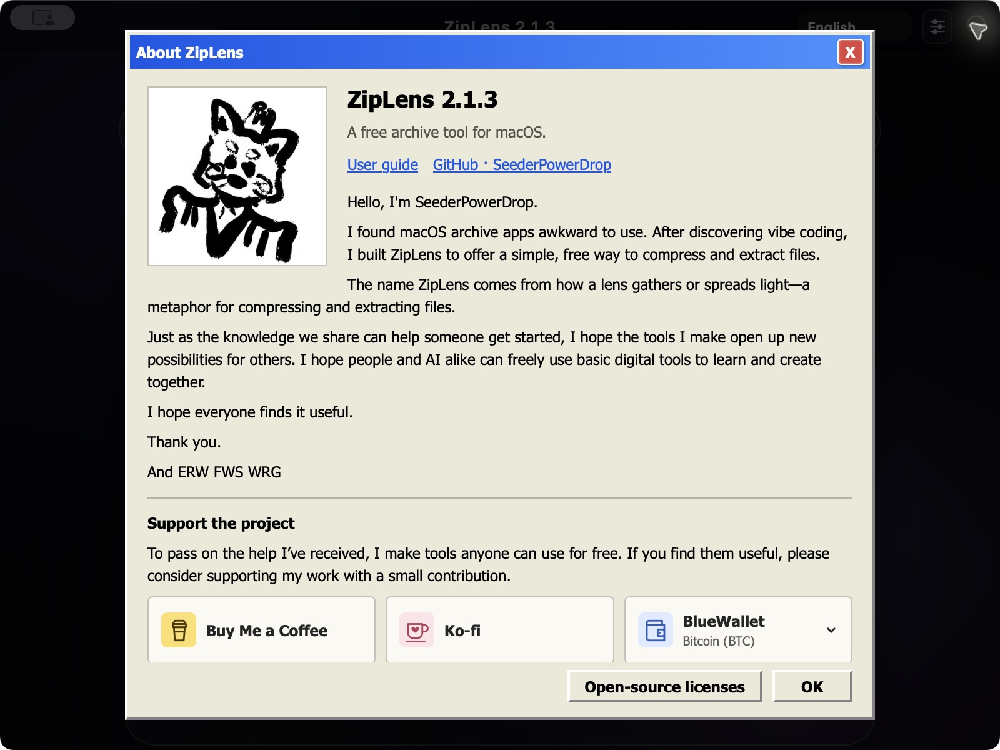

# ZipLens 2.1.3 — Introduction and user guide

[Languages](README.md) · [Download DMG](https://github.com/SeederPowerDrop/ZipLens/releases/download/v2.1.3/ZipLens_2.1.3_arm64-preview.dmg) · [Release, source and checksums](https://github.com/SeederPowerDrop/ZipLens/releases/tag/v2.1.3)

**Look inside before extracting, then choose only the files you need.** ZipLens is a free, ad-free macOS app by SeederPowerDrop. Lens illustrations represent compression and extraction.

## Features

- Browse folders, search names, select entries and preview supported small images and UTF-8 text.
- Create **ZIP, 7Z, TAR, TAR.GZ and TAR.ZST**. ZIP/7Z offer password and split options in the GUI. ALZ/EGG are extraction-only.
- Handle filename conflicts, cancel operations and review actual output paths and errors.
- Ten interface languages, GitHub guides and automation through the same app’s [JSON CLI](../AI_CLI.md). No separate AI API key is required.

## Install from DMG

1. Finish ongoing work, quit older copies with **⌘Q**, then open the DMG above.
2. Copy the **entire ZipLens.app to Applications**. Back up an existing installation before replacing it.
3. Launch the copied app, check **2.1.3** under **ⓘ**, then eject the DMG volume.

This is an **ad-hoc signed, unnotarized Apple Silicon preview**. A DMG does not replace Apple notarization; macOS may block launch. Operation on every other Mac is not guaranteed, and Intel execution is unverified. For a user-approved exception for an app whose source you trust, follow [Apple’s official instructions](https://support.apple.com/102445). [Actual DMG, download and installation checks](../INSTALLATION_VALIDATION_2.1.3_KO_EN.md).

## Everyday use

1. **Extract:** Drop or open an archive, browse and select entries, then choose extraction and a destination. Enter a password if requested.
2. **Compress:** Drop or select files/folders, choose a format and options, then an output name and destination. Start with Balanced; already compressed photos and videos may shrink little.
3. **Review:** Check actual output paths and failures. Cancellation or failure can leave files already completed. Keep every split-archive part together and open the first.

Change language at the top. **ⓘ → User guide / Help** opens the selected language’s GitHub `main` guide in a browser and requires internet access. If the browser cannot be launched, the bundled basic guide is shown. A network error after the browser opens does not trigger that fallback automatically. Licenses, optional support and the Bitcoin address/QR are also under **ⓘ**.

## Earlier performance measurements: 2.1.2

These are **October 18, 2026 engine/CLI results for 2.1.2**, not a 2.1.3 rerun. Environment: Apple M3, 24 GiB, macOS 15.7.5, compression level 6.

| Input | Observation |
|---|---|
| One 4 GiB + 64 MiB file, about 4.36 GB | 2.1.2 ZIP median: 64.9 s compression / 8.5 s extraction; two runs each |
| 10,000 × 4 KiB files; six follow-up runs per app | Extraction median: **0.722 s in 2.1.1 → 0.815 s in 2.1.2** |
| 512 MiB mixed corpus, 7Z compression | Peak process-tree RSS sampled every 100ms: about **1.71 GiB** |

The **40 round trips comprise 14 on 2.1.1 and 26 on 2.1.2**, with matching names, sizes and SHA-256 and unchanged originals. The small-file extraction median was about 12.8% higher, with overlapping ranges and an unresolved cause. We do not claim a universal speedup. RSS samples can miss short peaks or double-count shared pages. [Full results and limits](../LARGE_FILE_VALIDATION_2026-10-18.md)

## Limits

ZIP creation passwords require printable ASCII; choose 7Z for Unicode passwords. Interface language does not determine filename encoding. UTF-8 and valid Unicode-path metadata are supported, but untagged old ZIPs use a CP949-compatible fallback; CP932, GBK and CP437 names cannot always be recovered. Ask for UTF-8 ZIP or 7Z if needed. Text previews decode UTF-8; extraction does not change the original content’s encoding. OS dialogs follow system settings. Not every archive variant or Mac has been tested. [Format reference](../../README.md#지원-범위)

## Basic software rights and optional support

Everyone, regardless of income or language, should be able to use basic digital tools and study, modify, share and contribute to their code. Our guiding value of **basic software rights** includes people and AI sharing knowledge, learning and creating together.

ZipLens’s own code is [GPL-3.0-only](../../LICENSE); third-party licenses remain separate. Official [Buy Me a Coffee](https://buymeacoffee.com/master_chief), [Ko-fi](https://ko-fi.com/seederpower) and Bitcoin support are optional. Please retain the original project and author support links in modified distributions as a **voluntary request, not an additional GPL condition**.
