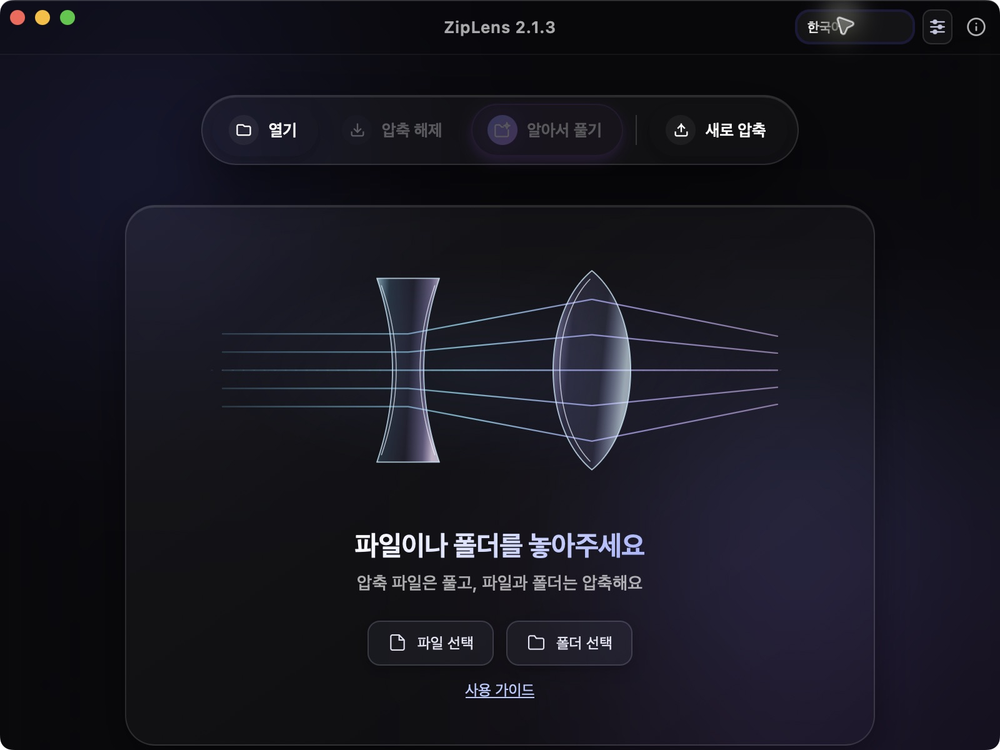

# ZipLens 2.1.3 — 소개와 사용법

[언어 선택](README.md) · [DMG 다운로드](https://github.com/SeederPowerDrop/ZipLens/releases/download/v2.1.3/ZipLens_2.1.3_arm64-preview.dmg) · [릴리스·소스·체크섬](https://github.com/SeederPowerDrop/ZipLens/releases/tag/v2.1.3)

**압축을 풀기 전에 확인하고, 필요한 파일만 꺼내세요.** SeederPowerDrop이 만드는 무료·광고 없는 macOS 앱입니다. 렌즈가 빛을 모으고 퍼뜨리는 모습으로 압축과 해제를 표현합니다.

## 주요 기능

- 목록·폴더 탐색·검색·선택 해제와 지원하는 작은 이미지·UTF-8 텍스트 미리보기.
- **ZIP, 7Z, TAR, TAR.GZ, TAR.ZST 생성.** GUI에서 ZIP·7Z 암호와 분할 옵션을 설정합니다. ALZ·EGG는 해제 전용입니다.
- 이름 충돌 처리, 취소, 실제 저장 경로와 오류를 보여 주는 결과 보고서.
- 10개 화면 언어, GitHub 사용 설명서, 같은 앱의 [JSON CLI](../AI_CLI.md)를 통한 자동화. 별도 AI API 키는 필요하지 않습니다.

## DMG로 설치

1. 진행 중인 작업을 마치고 구버전을 **⌘Q**로 종료한 뒤 위 DMG를 엽니다.
2. **ZipLens.app 전체를 응용 프로그램 폴더에 복사**합니다. 교체할 기존 앱은 먼저 백업하세요.
3. 복사한 앱을 실행해 **ⓘ**에서 **2.1.3**을 확인하고, 설치 후 DMG 볼륨을 추출합니다.

**Apple Silicon용 ad-hoc 서명·미공증 프리뷰**입니다. DMG가 Apple 공증을 대신하지 않으며 macOS가 실행을 차단할 수 있습니다. 모든 다른 Mac의 실행을 보장하지 않고 Intel 실행은 검증하지 않았습니다. 출처를 신뢰하는 앱의 사용자 허용 절차는 [Apple 공식 안내](https://support.apple.com/102445)를 따르세요. [실제 DMG·다운로드·설치 검증](../INSTALLATION_VALIDATION_2.1.3_KO_EN.md).

## 기본 사용 순서

1. **압축 해제:** 압축 파일을 창에 놓거나 열기로 선택합니다. 폴더를 탐색하고 필요한 항목을 체크한 뒤 압축 해제와 저장 폴더를 선택합니다. 요청 시 암호를 입력합니다.
2. **새 압축:** 파일·폴더를 놓거나 선택하고 형식·옵션·저장 이름을 정합니다. 우선 균형 설정으로 시작하세요. 이미 압축된 사진·영상은 거의 줄지 않을 수 있습니다.
3. **결과 확인:** 실제 저장 경로와 실패 항목을 확인합니다. 취소·실패 전에 완료된 파일은 남을 수 있습니다. 분할 압축은 모든 조각을 같은 폴더에 두고 첫 조각을 엽니다.

상단에서 언어를 바꿉니다. **ⓘ → 사용 가이드**는 해당 언어의 GitHub `main` 문서를 브라우저에서 열며 인터넷이 필요합니다. 브라우저를 실행하지 못하면 내장 기본 가이드를 표시합니다. 브라우저가 열린 뒤 발생하는 인터넷 연결 오류까지 내장 가이드로 자동 전환하는 것은 아닙니다. 라이선스·공식 후원·Bitcoin 주소와 QR 코드도 **ⓘ**에서 확인합니다.

## 기존 성능 측정: 2.1.2

아래는 **2026-10-18의 2.1.2 CLI/엔진 검사**이며 2.1.3 재측정이 아닙니다. Apple M3·24 GiB·macOS 15.7.5, 압축 수준 6 조건입니다.

| 조건 | 결과 |
|---|---|
| 단일 4 GiB + 64 MiB, 약 4.36 GB | 2.1.2 ZIP 압축 64.9초 / 해제 8.5초 중앙값, 각 2회 |
| 4 KiB 파일 10,000개, 후속 각 6회 | 해제 중앙값 2.1.1 **0.722초 →** 2.1.2 **0.815초** |
| 512 MiB 혼합 표본, 7Z 압축 | 100ms 프로세스 트리 RSS 샘플 최고치 약 **1.71 GiB** |

**40왕복 = 2.1.1 14 + 2.1.2 26**에서 파일 이름·크기·SHA-256과 원본 보존을 확인했습니다. 작은 파일 해제 중앙값은 약 12.8% 높았고 원인은 미확정입니다. 범위는 겹치며 모든 조건의 성능 개선을 주장하지 않습니다. 메모리 샘플은 짧은 최고치를 놓치거나 공유 페이지를 중복 계산할 수 있습니다. [전체 결과와 한계](../LARGE_FILE_VALIDATION_2026-10-18.md)

## 알아둘 한계

ZIP 생성 암호는 출력 가능한 ASCII를 사용하고 Unicode 암호에는 7Z를 선택하세요. 화면 언어와 파일명 인코딩은 별개입니다. UTF-8·유효한 Unicode 경로 정보는 지원하지만, 무태그 구형 ZIP은 CP949 호환 해석을 사용하므로 CP932·GBK·CP437 이름을 항상 복원하지 못합니다. 필요하면 제작자에게 UTF-8 ZIP이나 7Z를 요청하세요. 텍스트 미리보기는 UTF-8이며 해제는 파일 내용의 인코딩을 바꾸지 않습니다. OS 창의 언어·모든 압축 변종·모든 Mac의 성능을 보장하지 않습니다. [지원 범위](../../README.md#지원-범위)

## 소프트웨어 기본권과 선택적 후원

누구나 경제적 여건이나 언어와 관계없이 기본 디지털 도구를 쓰고, 코드를 공부·수정·공유·기여할 수 있기를 바랍니다. 사람과 AI가 지식을 나누고 함께 배우며 창작하는 **소프트웨어 기본권**을 개발의 지향점으로 삼습니다.

자체 코드는 [GPL-3.0-only](../../LICENSE)이며 외부 구성요소의 라이선스는 별도로 유지합니다. 공식 [Buy Me a Coffee](https://buymeacoffee.com/master_chief)·[Ko-fi](https://ko-fi.com/seederpower)·Bitcoin 후원은 선택입니다. 수정본에 원작과 원작자 후원 링크를 남겨 달라는 안내는 **자발적인 부탁이며 GPL의 추가 조건이 아닙니다.**
